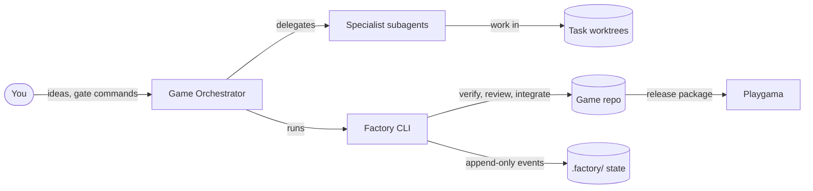

<div align="center">

# Automated Game Factory

**An AI production pipeline that takes an HTML5 game from idea to Playgama release, with a human signing off every decision that matters.**

[](LICENSE)


[Overview](#overview) · [How it works](#how-it-works) · [Quick start](#quick-start) · [Human gates](#human-gates) · [Configuration](#configuration) · [Documentation](#documentation)

</div>

---

## Overview

Automated Game Factory is a [Claude Code](https://claude.com/claude-code) project. You describe a game idea and a
team of AI agents designs, builds, tests and packages an original HTML5 game for
[Playgama](https://playgama.com).

It is built around three principles:

- **The state lives in the CLI, not in the chat.** A deterministic factory CLI records production state in
  append-only event logs. Any session rebuilds the full state from them, so nothing depends on conversation history.
- **Machines verify, a second agent reviews.** Every task passes automated checks run by the CLI, then an independent
  review by a different agent role, before it is integrated.
- **Humans decide.** Concept, spec, every development phase, playtest, release and every external Playgama operation
  need a signed approval that only a command you type can create.

### Key features

| | |
|---|---|
| **Multi-agent team** | An orchestrator plus specialists: game designer, market analyst, tech architect, game developer, platform engineer, asset producer, QA engineer, code reviewer and release manager. |
| **Signed human gates** | A hook mints a single-use, signed approval token when you type a gate command; the CLI refuses the transition without it. Plain-chat agreement is never an approval. |
| **Isolated parallel work** | Each game is its own git repository; each task runs in its own worktree and branch with a disjoint file scope. |
| **Deterministic verification** | Scope checks, secret and external-URL scans, typecheck, lint, unit tests, build, build validation and Playwright e2e, all run by the CLI. |
| **Crash-safe recovery** | Claims, attempts and reviews are recorded as events; after a restart the factory reports and resolves stale work. |
| **Playgama-ready output** | Phaser + TypeScript template with Playgama Bridge integration, a shared runtime kit, compliance standards and publication packaging. |
| **Licence-checked assets** | A local asset library with licence verification and a per-game licence ledger. |

---

## How it works



### Lifecycle

```mermaid
flowchart LR
    I[IDEATION] -->|/approve-concept| CA[CONCEPT_APPROVED]
    CA --> SD[SPEC_DRAFT]
    SD -->|/approve-spec| SA[SPEC_APPROVED]
    SA -->|/start-development| DA[DEV_AUTHORIZED]
    DA --> D[DEVELOPMENT<br/>phases]
    D -->|/approve-phase| D
    D --> RC[RC_READY]
    RC --> PT[PLAYTEST]
    PT -->|/approve-playtest| PA[PLAYTEST_APPROVED]
    PA -->|/approve-release| RA[RELEASE_APPROVED]
    RA --> PK[PACKAGED]
    PK --> PP[PUBLICATION_PREPARED]
    PP -->|/archive-game| AR[ARCHIVED]
```



A draft game (`IDEATION` to `SPEC_APPROVED`) can be dropped with `/abandon-game` (`ABANDONED`).

### The task loop

During development every phase is a DAG of tasks. For each task the factory:

1. **Starts** an attempt in a dedicated worktree and dispatches it to the assigned agent.
2. **Verifies** the result deterministically (scope, scans, typecheck, lint, tests, build, e2e).
3. **Reviews** it with an independent agent against measurable acceptance criteria, using one strictly validated
   review schema. An agent never reviews its own work.
4. **Integrates** accepted work, or retries (on a stronger model for attempts ≥ 2) and eventually escalates to you.

At the end of each phase you receive a checkpoint report and decide whether to continue.

---

## Prerequisites

| Requirement | Notes |
|---|---|
| [Claude Code](https://claude.com/claude-code) | Runs the orchestrator and all subagents. |
| Node.js ≥ 22 | Runs the factory CLI and hooks. |
| git | Game repositories and task worktrees. |
| pnpm via corepack | The factory runs `corepack pnpm ...`. |
| Google Chrome *or* Playwright Chromium | e2e tests and cover screenshots (`PW_CHANNEL=bundled` for bundled Chromium). |
| ffmpeg | Audio processing. |
| Playgama Developer Cabinet plugin | Declared in `.claude/settings.json` (marketplace `Playgama/playgama-plugins`). |
| Filesystem with hard links | NTFS, APFS, ext4 and similar; not FAT/exFAT or a network share. |

---

## Quick start

**1. Clone and open in Claude Code**

```bash
git clone https://github.com/OzodN/automated-game-factory.git
cd automated-game-factory
claude
```

Trust the project and its plugin when prompted. The session starts as the **game-orchestrator**.

**2. Check the environment**

```bash
node factory/cli/factory.mjs doctor
```

Fix every `FAIL` row. See the [operator manual](docs/factory/OPERATOR-MANUAL.md) for `WARN` rows.

**3. Sign in to Playgama**

In Claude Code run `/mcp`, select `plugin:playgama-developer-cabinet:playgama` and choose **Authenticate**.

**4. Set up the asset library**

Point the `GAME_ASSET_LIBRARY` environment variable, or `"assetLibrary"` in `factory/config.json`, at any local
folder (a synced drive works too). Without it a local fallback under `.cache/` is used.

```bash
node factory/cli/factory.mjs assets where
```

Seed the library with CC0 packs you downloaded yourself (for example Kenney or OpenGameArt) by asking the
orchestrator to ingest them. Every pack is licence-checked.

**5. Start your first game**

```text
/game-new a one-button rhythm runner where you jump over obstacles on the beat
```

The orchestrator runs ideation with the designer, analyst and architect, then presents a concept brief for your
approval.

---

## Human gates

Gate commands are the only way to move a game forward. Each one mints a signed, single-use approval.

| Command | Authorizes |
|---|---|
| `/approve-concept` | The Game Concept Brief. |
| `/approve-spec` | The specification set: GDD, technical design, art/audio, Playgama integration, test plan. |
| `/start-development` | Freezing the spec, scaffolding the game repository and loading the phase plan. |
| `/approve-phase` · `/reject-phase <reason>` · `/request-changes <text>` | A phase checkpoint. |
| `/retry-task <ID>` · `/abandon-task <ID>` | Handling a blocked task. |
| `/modify-requirements <text>` · `/approve-spec-change` | A change to the approved requirements. |
| `/approve-playtest` · `/reject-playtest <issues>` | The release candidate, after your own playtest. |
| `/approve-release <x.y.z>` | The release (merge `develop` → `main`, tag); packaging and archive validation follow. |
| `/authorize-publish <op>` | Exactly one Playgama operation: `draft`, `store-config`, `sandbox`, `catalog-update`, `traffic` or `referral`. |
| `/archive-game` · `/abandon-game <reason>` | Archiving a game; dropping a draft game. |
| `/pause` · `/resume` | Pausing or resuming a game (no new tasks start while paused). |

**Other commands:** `/game-new <idea>`, `/game-status`, `/game-focus <id>`, `/factory-metrics`,
`/prepare-publication`.

> **Note:** submission for moderation is done by you in the Playgama console; it is not available to agents.

---

## Configuration

All settings live in `factory/config.json`.

| Setting | Description |
|---|---|
| `humanLanguage` | Language of the human ↔ orchestrator conversation. `auto` (default) replies in the language you write in; a code such as `en` or `ru` fixes it. Override with `FACTORY_HUMAN_LANGUAGE`. Artifacts, code, commits and subagent prompts are always English. |
| `models` | Pinned model and effort for every subagent, plus the stronger `-retry` variants. Apply changes with `node factory/cli/gen-agent-models.mjs`; `doctor` checks that agent files match. |
| `concurrency`, `maxActiveAgents`, `maxAttempts` | Parallelism and retry limits. |
| `assetLibrary` | Path to the asset library (or use `GAME_ASSET_LIBRARY`). |

The release size budget is configured in the same file.

<details>
<summary><strong>Environment overrides</strong></summary>

| Variable | Overrides |
|---|---|
| `FACTORY_ROOT` | Factory root directory |
| `FACTORY_STATE_DIR` | Event-log state directory (`.factory/`) |
| `FACTORY_CONFIG` | Path to `config.json` |
| `FACTORY_GAMES_DIR` | Game repositories (`games/`) |
| `FACTORY_WORKTREES_DIR` | Task worktrees (`.worktrees/`) |
| `FACTORY_INBOX_DIR` | Agent reports and reviews (`.inbox/`) |
| `FACTORY_ARCHIVE_DIR` | Release archives (`archive/`) |
| `FACTORY_TEMPLATES_DIR` | Game templates |
| `FACTORY_KIT_DIR` | Shared runtime kit |
| `FACTORY_TMP_DIR` | Scratch directory (`.cache/tmp`) |
| `FACTORY_KEY_PATH` | Approval signing key (default `~/.game-factory/approval.key`) |
| `FACTORY_HUMAN_LANGUAGE` | `humanLanguage` |

</details>

---

## Repository layout

```text
.claude/
  agents/                 Agent definitions (orchestrator and specialists)
  skills/                 Gate commands and mode playbooks
factory/
  cli/                    Factory CLI (factory.mjs), library and tests
  hooks/                  Claude Code hooks: approval minting, guard, provenance, session context
  standards/              MUST/SHOULD rules with IDs (engineering, quality, Playgama, security, assets)
  knowledge/              Verified Playgama facts and Claude Code capabilities
  templates/
    game-phaser-ts/       Game template (Phaser, TypeScript, Vite, Playgama Bridge)
packages/
  pg-kit/                 Shared runtime kit, released as immutable tarballs
docs/
  factory/                Operator manual, architecture, project status
  playgama-research/      Background research on Playgama (Russian, secondary source)
```

Runtime folders (`.factory/`, `games/`, `.worktrees/`, `.inbox/`, `archive/`, `.cache/`) are created locally and
are not tracked.

---

## Documentation

| Document | Contents |
|---|---|
| [Operator manual](docs/factory/OPERATOR-MANUAL.md) | Day-to-day operation, setup details, troubleshooting. |
| [Architecture](docs/factory/ARCHITECTURE.md) | Components, state model, guards and data flow. |
| [Project status](docs/factory/STATUS.md) | What is implemented and known limitations. |
| [Standards](factory/standards/) | The rules agents and the CLI enforce. |
| [Contributing](CONTRIBUTING.md) | How changes to the factory itself are made and reviewed. |

---

## Platform support

Developed and tested on **Windows**. **macOS** and **Linux** are supported on a best-effort basis; issues and pull
requests are welcome.

## Safety and responsibility

- Agents never publish on their own. Every Playgama operation needs an explicit `/authorize-publish <op>` that you
  type for that game and build.
- You are responsible for the licences of the assets you use and for everything you publish.
- This project is **not affiliated with, endorsed by or sponsored by Playgama**.

## Contributing

Contributions are welcome. Please read [CONTRIBUTING.md](CONTRIBUTING.md) first: factory changes go through the
factory's own maintenance flow, with an isolated worktree, an independent review and a verified merge.

## License

Released under the [MIT License](LICENSE).
