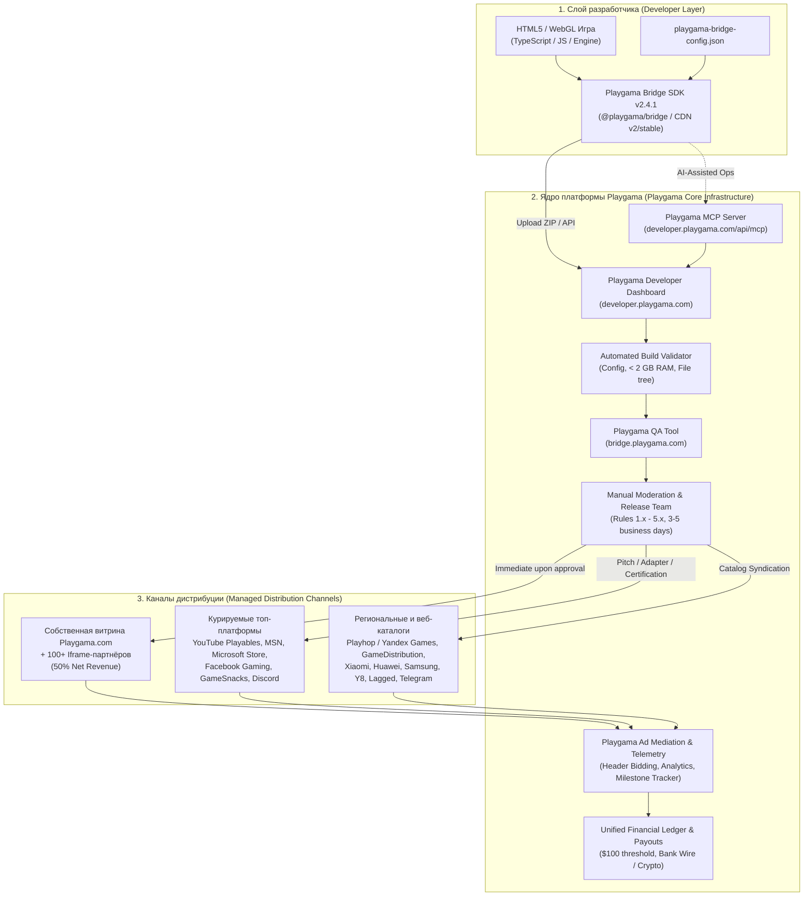
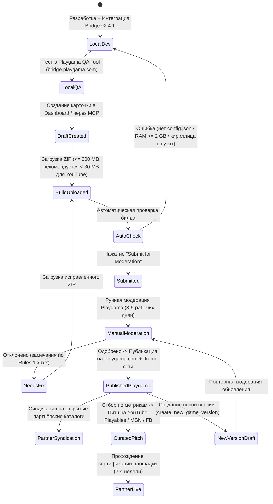

# 01. Обзор платформы и экосистемы Playgama (Playgama Platform Overview)

> **Статус документа:** `VERIFIED`  
> **Дата последней верификации:** `2026-11-08`  
> **Целевая модель дистрибуции:** Исключительно через единое окно Playgama (`Single-Point Managed Distribution`)  
> **Базовые источники:** [Playgama Wiki — Introduction](https://wiki.playgama.com/playgama), [Playgama Quick Start](https://wiki.playgama.com/playgama/quick-start), [FAQ — General](https://wiki.playgama.com/playgama/faq/general), [Playgama MCP Server](https://wiki.playgama.com/playgama/mcp)

---

## 1. Архитектура экосистемы Playgama

**Playgama** (юридическое лицо — **LeadToChanges L.L.C-FZ**, Дубай, ОАЭ; статус: `VERIFIED`, источник: `https://playgama.com/termsofuse`) представляет собой **B2B2C-платформу дистрибуции и монетизации HTML5-игр (PaaS для веб-гейминга)**. Экосистема спроектирована по принципу «один билд — один SDK — один личный кабинет — множество каналов распространения и единый кошелёк выплат».

### 1.1. Три уровня дистрибуции внутри Playgama (`VERIFIED`)

| Уровень | Описание канала | Механика публикации | Доля разработчика (Net Revenue) | Источник |
|---|---|---|---|---|
| **Уровень 1: Собственная сеть Playgama** | Флагманский портал `playgama.com` + партнёрская сеть из **100+ нишевых сайтов и веб-мастеров**, встраивающих каталог Playgama через `iframe`. | Автоматически сразу после прохождения базовой модерации Playgama (3–5 рабочих дней). | **50%** (`VERIFIED`) | [FAQ — Payments and Statistics](https://wiki.playgama.com/playgama/faq/payments-and-statistics) |
| **Уровень 2: Открытая и полуавтоматическая партнёрская синдикация** | Крупные веб-каталоги и OEM-витрины, куда Playgama поставляет проверенные игры напрямую: **GameDistribution, Y8, Lagged, Playhop / Yandex Games (при наличии RU-локализации), Xiaomi, Huawei, Samsung, Telegram, Reddit, JioGames, Dlightek/Aha**. | Playgama самостоятельно отправляет билд и метаданные в партнёрские кабинеты; статус отслеживается во вкладке **Platforms** в Dashboard. | **70% / 80% / 90%** (прогрессивная шкала от месячного оборота; `VERIFIED`) | [Submitting a Game](https://wiki.playgama.com/playgama/submitting-a-game), [Platform-specific requirements](https://wiki.playgama.com/playgama/game-requirements/platform-specific-requirements) |
| **Уровень 3: Курируемые стратегические платформы (Pitch & Certification)** | Закрытые экосистемы с жёстким отбором и собственной сертификацией: **YouTube Playables, MSN (Microsoft Start), Microsoft Store, Facebook Gaming (Play Lab → Play Tab), GameSnacks (Google), Discord Activities**. | Команда Playgama мониторит метрики игры на Уровнях 1–2 (или отбирает перспективные тайтлы), питчит их менеджерам площадки и сопровождает процесс сертификации (от 1 до 4+ недель). | **70%–90%** (общая шкала) или **75% / 25%** (специальные условия YouTube Playables; см. Раздел 06 и 09) | [Publish on YouTube Playables](https://playgama.com/publish-your-game-on-youtube-playables/), [Publish on MSN](https://playgama.com/how-to-publish-game-on-msn) |

> [!WARNING]
> **Площадки, где Playgama НЕ выступает издателем (`VERIFIED`):**  
> Согласно официальной документации ([Playgama Wiki — Introduction](https://wiki.playgama.com/playgama) и [Platform-specific requirements](https://wiki.playgama.com/playgama/game-requirements/platform-specific-requirements)), Playgama **не публикует игры самостоятельно на Poki, CrazyGames и VK**, а публикация на **TikTok временно приостановлена** из-за низкого трафика. Хотя в SDK `Playgama Bridge` присутствуют технические адаптеры (`poki`, `crazy_games`, `vk`, `tiktok`), в рамках стратегии «публикация исключительно через Playgama без сторонних кабинетов» эти 4 канала не задействуются.

---

## 2. Роль Playgama Bridge SDK (`v2.4.1`)

**Playgama Bridge** ([GitHub: Playgama/Bridge](https://github.com/Playgama/Bridge), актуальная версия **`v2.4.1`** от `2026-11-05`, лицензия `LGPL-3.0-or-later`) — кроссплатформенный абстрактный слой (SDK-фасад) для HTML5-игр.

### 2.1. Какие задачи решает Bridge SDK (`VERIFIED`)
1. **Единый API вместо 25+ нативных SDK:** Игра вызывает унифицированные методы (`bridge.platform`, `bridge.storage`, `bridge.advertisement`, `bridge.player`, `bridge.payments`, `bridge.leaderboards` и др.), а `PlaygamaBridge` во время инициализации автоматически определяет среду запуска (по URL-параметру `platform_id`, глобальным объектам вроде `window.ytgame` или `playgama-bridge-config.json`) и создаёт экземпляр нужного платформенного моста (`PlaygamaPlatformBridge`, `YoutubePlatformBridge`, `MsnPlatformBridge`, `YandexPlatformBridge` и т.д.).
2. **Динамическая подгрузка платформенного бандла (CDN-режим):** При подключении через официальный CDN (`https://bridge.playgama.com/v2/stable/playgama-bridge.js`) загрузчик скачивает только легковесное ядро и динамически подгружает скрипт конкретной целевой платформы (`chunks/[platformId].bridge.js`), экономя размер стартового бандла (`VERIFIED`, источник: [Bridge SDK — Setup](https://wiki.playgama.com/playgama/bridge-sdk/setup)).
3. **Централизованная конфигурация без пересборки кода:** Файл `playgama-bridge-config.json` в корне архива хранит платформозависимые идентификаторы (ID рекламных блоков, таблиц лидеров, каталога IAP-товаров, достижений и соц. постов) и позволяет переопределять их точечно для конкретных площадок через блок `platforms: { ... }` (`VERIFIED`, источник: [Bridge SDK — Config file](https://wiki.playgama.com/playgama/bridge-sdk/config)).
4. **Встроенная телеметрия и защита браузерного окружения:**
   - Автоматически трекает этапы инициализации и вехи геймплея (`GameplayMilestoneTracker`: `0s`, `30s`, `60s`, `120s`, `300s`, `600s` активного `gameplay_started` времени).
   - Управляет частотой показа Interstitial-рекламы (`InterstitialController`, дефолтный `60s` cooldown + поддержка дистанционного управления частотой со стороны платформы через `configureAdFrequency`).
   - Применяет защиту от браузерных дефолтов (`applyBrowserDefaultsProtection()` — блокировка нежелательного скролла, зума и контекстного меню на мобильных WebView).

---

## 3. Отношения между Разработчиком, Playgama и Партнёрскими площадками

В выбранной модели работы («единое окно Playgama») договорные, технические и финансовые потоки выстроены следующим образом (`VERIFIED`, источники: [Terms of Use](https://playgama.com/termsofuse), [License Agreement](https://playgama.com/license), [Developer Terms](https://developer.playgama.com/terms)):

| Аспект отношений | Роль Разработчика (Вы) | Роль Playgama (`LeadToChanges L.L.C-FZ`) | Роль Партнёрских площадок (YouTube, MSN, FB, Yandex и др.) |
|---|---|---|---|
| **Юридический договор** | Заключает единое неэксклюзивное лицензионное соглашение с Playgama в Developer Dashboard. Сохраняет 100% прав интеллектуальной собственности (IP) на игру. | Выступает глобальным лицензиатом и дистрибутором с правом сублицензирования игры партнёрским сетям и встраивания рекламы. | Имеют прямые B2B-контракты с Playgama; разработчик не подписывает отдельные договоры с YouTube, Microsoft или Meta. |
| **Техническая интеграция** | Интегрирует только `Playgama Bridge SDK v2.4.1` и `playgama-bridge-config.json`. Готовит один универсальный ZIP-архив. | Поддерживает актуальность 25 платформенных адаптеров внутри `Bridge`, хостит CDN `v2/stable`, инжектирует нативные SDK площадок при деплое. | Предоставляют свои хостинг-контейнеры / WebView / `window.ytgame` API, которые прозрачно вызываются через `Playgama Bridge`. |
| **Модерация и QA** | Проводит самопроверку по чеклисту `game-self-check` и в `QA Tool`, устраняет замечания модераторов Playgama. | Проводит первичную техническую и продуктовую модерацию (3–5 рабочих дней), затем подаёт билд на сертификацию партнёрам и транслирует фидбек разработчику. | Выполняют финальный платформенный ревью (например, YouTube Test Suite 3–7 дней или Facebook Play Lab тестирование). |
| **Монетизация и выплаты** | Получает единый отчёт по всем площадкам в Dashboard и выводит средства одной транзакцией (от $100) на банковский счёт или в криптовалюте. | Инкассирует рекламную и IAP-выручку от всех рекламных сетей и партнёрских порталов, удерживает комиссию платформы и выплачивает долю разработчику. | Выплачивают агрегированный доход компании Playgama согласно своим корпоративным циклам расчётов (Net 30 / Net 60). |

---

## 4. Инструменты разработчика в экосистеме Playgama

### 4.1. Playgama Developer Dashboard (`https://developer.playgama.com`) (`VERIFIED`)
Веб-панель управления жизненным циклом игр и финансами:
- **Управление проектами и черновиками (`Drafts`):** создание карточек игр, загрузка обложек, иконок, скриншотов, видеогеймплея, локализованных названий и описаний.
- **Управление сборками (`Builds / Versions`):** загрузка ZIP-архивов, автоматический сканер сборки (проверка `playgama-bridge-config.json`, структуры папок, пикового потребления ОЗУ `< 2 GB`), предпросмотр игры по закрытой тестовой ссылке (`Preview Link`).
- **Мониторинг модерации и дистрибуции (`Platforms`):** отслеживание статуса каждой партнёрской площадки в реальном времени (`In Review`, `Published`, `Rejected` с комментариями причин отказа).
- **Аналитика и финансы (`Analytics & Balance`):** графики показов, сессий, выручки, eCPM, удержания, баланс кошелька и создание заявок на выплату.

### 4.2. Playgama QA Tool (`https://bridge.playgama.com`) (`VERIFIED`)
Специализированный инструмент интерактивного тестирования интеграции SDK ([Quick Start — Step 2](https://wiki.playgama.com/playgama/quick-start)):
- Позволяет загрузить локальный ZIP-билд или протестировать загруженный черновик.
- Визуально отображает в реальном времени все входящие вызовы от игры к `Playgama Bridge` (`initialize`, `game_ready`, `gameplay_started`, `gameplay_stopped`, `showInterstitial`, `showRewarded`, `storage.get/set`).
- Позволяет эмулировать события платформы: принудительную паузу (`PAUSE_STATE_CHANGED`), отключение звука (`AUDIO_STATE_CHANGED`), успешный или неуспешный показ рекламы, смену языка и состояния авторизации.

### 4.3. Playgama MCP Server (`https://developer.playgama.com/api/mcp`) (`VERIFIED`)
Официальный **Model Context Protocol (MCP)** сервер Playgama ([Playgama MCP](https://wiki.playgama.com/playgama/mcp), [MCP Tools](https://wiki.playgama.com/playgama/mcp/tools)), позволяющий управлять публикацией, загрузкой билдов и аналитикой напрямую из AI-агентов (Claude Code, Cursor, VS Code, Antigravity) по Personal Access Token (PAT) из Dashboard:

| Группа MCP-инструментов | Доступные инструменты (`VERIFIED`) | Назначение |
|---|---|---|
| **Игры и версии** | `get_games`, `get_game`, `create_game`, `create_new_game_version`, `update_game_version`, `submit_game_version` | Создание проекта, создание новой версии после релиза, обновление метаданных и отправка черновика на модерацию. |
| **Загрузка файлов и ассетов** | `upload_build`, `upload_asset`, `delete_asset`, `generate_game_assets_Change_Text_And_Details` | Прямая загрузка ZIP-архива игры (через multipart upload), загрузка/удаление иконок, обложек, скриншотов и геймплейного видео. |
| **Справочники** | `get_genres`, `get_tags`, `get_platforms` | Получение актуальных системных ID жанров, тегов и списка партнёрских платформ. |
| **Аналитика и телеметрия** | `get_games_analytics` | Выгрузка метрик (`impressions`, `revenue`, `bounces`, `sessions`, `retention`) и кастомных событий `bridge.analytics.send()` с фильтрацией по датам и платформам. |

---

## 5. Процедура загрузки, модерации, обновления и удаления игры

### 5.1. Полный жизненный цикл публикации игры (`VERIFIED`)

### 5.2. Обновление опубликованной игры (`VERIFIED`)
- Опубликованная версия игры остаётся доступной игрокам и продолжает приносить доход во время работы над обновлением ([MCP Tools — `create_new_game_version`](https://wiki.playgama.com/playgama/mcp/tools)).
- Разработчик создаёт новый черновик версии (`New Version`), загружает обновлённый ZIP-архив и при необходимости обновляет ассеты или описание.
- Новая версия проходит повторную автоматическую проверку и модерацию перед тем, как заменить текущий продакшен-билд на `playgama.com` и быть разосланной партнёрским площадкам.

### 5.3. Удаление игры (Withdrawal / Takedown) (`VERIFIED`)
- Поскольку лицензия является **неэксклюзивной** ([FAQ — General](https://wiki.playgama.com/playgama/faq/general), [License Agreement](https://playgama.com/license)), разработчик имеет право отозвать/удалить свою игру.
- Удаление опубликованной игры выполняется через письменный запрос в команду поддержки Playgama (`developer.success@playgama.com` / чат в Dashboard), так как требуется депубликация не только с `playgama.com`, но и каскадное снятие билда с внешних партнёрских витрин (см. детальный юридический разбор в `10-privacy-and-legal.md`).
