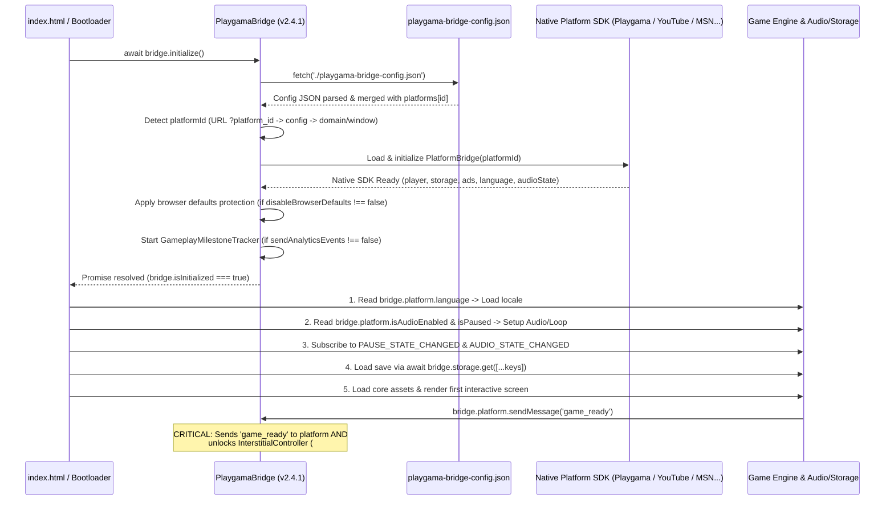

# 03. Полный технический аудит и справочник Playgama Bridge SDK v2.4.1 (Bridge SDK Reference — Deliverable B)

> **Статус документа:** `VERIFIED`  
> **Дата последней верификации:** `2026-11-08`  
> **Актуальная версия SDK:** **`v2.4.1`** (релиз `2026-11-05`, npm: `@playgama/bridge@2.4.1`, лицензия `LGPL-3.0-or-later`)  
> **Первичные источники:**  
> - [GitHub Repository — Playgama/Bridge (`v2.4.1`)](https://github.com/Playgama/Bridge)  
> - [Bridge SDK v2 — Getting Started](https://wiki.playgama.com/playgama/bridge-sdk/getting-started)  
> - [Bridge SDK v2 — Setup](https://wiki.playgama.com/playgama/bridge-sdk/setup)  
> - [Bridge SDK v2 — Config File](https://wiki.playgama.com/playgama/bridge-sdk/config)  
> - [Bridge SDK v2 — Core API & Error Codes](https://wiki.playgama.com/playgama/bridge-sdk/api)  
> - [Bridge SDK v2 — Migration v1 to v2](https://wiki.playgama.com/playgama/bridge-sdk/migration-v1-to-v2)

---

## 1. Архитектура SDK, способы подключения и точки входа

### 1.1. Способы установки (`VERIFIED`)

| Способ подключения | Когда использовать | Как работает под капотом | Источник |
|---|---|---|---|
| **1. Официальный CDN (`Recommended`)** `<script src="https://bridge.playgama.com/v2/stable/playgama-bridge.js"></script>` | Универсальный вариант для любых сборщиков и движков. | Загружает легковесный загрузчик (`playgama-bridge.js`), определяет текущую площадку и **динамически подгружает только один чанк** нужного платформенного моста (`chunks/[platformId].bridge.js`), минимизируя размер стартового бандла. Вносит глобальный объект `window.bridge`. | [Setup](https://wiki.playgama.com/playgama/bridge-sdk/setup) |
| **2. NPM + Vite Plugin (`Recommended for TypeScript + Vite`)** `npm i @playgama/bridge` + `@playgama/bridge/vite` | Проекты на TypeScript/JavaScript со сборщиком Vite. | Плагин `playgamaBridge()` инжектирует CDN-скрипт (или при `{ mode: 'local' }` копирует чанки SDK локально в `dist/` для офлайн-отладки) и автоматически обслуживает `playgama-bridge-config.json`. | [Setup](https://wiki.playgama.com/playgama/bridge-sdk/setup) |
| **3. Прямой ESM-импорт из NPM** `import bridge from '@playgama/bridge'` | Бандлинг средствами Webpack/Rollup/esbuild без Vite-плагина. | Включает ядро SDK напрямую в ваш JS-бандл (требует размещения чанков или работы через встроенный динамический импорт). | [`package.json`](https://github.com/Playgama/Bridge/blob/main/package.json) |

### 1.2. Экспорты пакета `@playgama/bridge@2.4.1` (`VERIFIED`, из `package.json`)

```typescript
// 1. Полный SDK (инстанс синглтона PlaygamaBridge + все константы и типы)
import bridge, {
  PLATFORM_ID,
  MODULE_NAME,
  EVENT_NAME,
  ERROR_CODE,
  BridgeError,
  INTERSTITIAL_STATE,
  REWARDED_STATE,
  BANNER_STATE,
  BANNER_POSITION,
  PLATFORM_MESSAGE,
  DEVICE_TYPE,
  ORIENTATION,
  LEADERBOARD_TYPE,
} from '@playgama/bridge';

// 2. Только константы и классы ошибок (Tree-shakable, 0 побочных эффектов — идеально при загрузке ядра с CDN)
import {
  PLATFORM_ID,
  EVENT_NAME,
  ERROR_CODE,
  BridgeError,
  INTERSTITIAL_STATE,
  REWARDED_STATE,
  BANNER_STATE,
  BANNER_POSITION,
  PLATFORM_MESSAGE,
  DEVICE_TYPE,
} from '@playgama/bridge/constants';

// 3. Глобальные типы для window.bridge (при использовании CDN без бандлинга самого SDK)
import '@playgama/bridge/global';

// 4. Vite-плагин (в vite.config.ts)
import { playgamaBridge } from '@playgama/bridge/vite';
```

---

## 2. Конфигурационный файл `playgama-bridge-config.json` (`Rule 1.1.1`)

> [!IMPORTANT]
> Начиная с **Playgama Bridge v2**, наличие валидного файла `playgama-bridge-config.json` рядом с `index.html` является **строго обязательным** (`Mandatory`). При его отсутствии `bridge.initialize()` выбрасывает `BridgeError` с кодом `ERROR_CODE.CONFIG_LOAD_FAILED` (или `CONFIG_PARSE_FAILED`), а автоматический чекер Playgama Dashboard отклоняет ZIP-архив при загрузке.

### 2.1. Полная схема `playgama-bridge-config.json` (`VERIFIED`, из `src/lib/bridge-config/types.ts`)

```json
{
  "$schema": "https://bridge.playgama.com/v2/stable/schema.json",
  "forciblySetPlatformId": "",
  "sendAnalyticsEvents": true,
  "disableBrowserDefaults": true,
  "gameDistributionGameId": "",
  "y8GameId": "",
  "y8ChannelId": "",
  "y8AdsenseId": "",
  "laggedDevId": "",
  "laggedPublisherId": "",
  "facebookPlacementId": "",
  "adsgramBlockId": "",
  "advertisement": {
    "minimumDelayBetweenInterstitial": 60,
    "interstitial": {
      "preload": true,
      "placements": [
        {
          "id": "level_complete",
          "vk": "vk_interstitial_id",
          "huawei": "huawei_interstitial_id"
        }
      ]
    },
    "rewarded": {
      "preload": true,
      "placements": [
        {
          "id": "revive_player",
          "vk": "vk_rewarded_id"
        },
        {
          "id": "double_coins"
        }
      ]
    },
    "banner": {
      "placements": [
        {
          "id": "main_bottom_banner"
        }
      ]
    },
    "advancedBanners": {
      "placements": [
        {
          "id": "menu_side_banner",
          "views": [
            {
              "devices": ["desktop"],
              "orientations": ["landscape", "portrait"],
              "width": "20%",
              "height": "60%",
              "right": "2%",
              "top": "20%"
            }
          ]
        }
      ]
    }
  },
  "payments": [
    {
      "id": "coins_pack_small",
      "playgama": { "id": "pg_coins_100", "amount": 99 },
      "yandex": "ya_coins_100",
      "msn": "msn_coins_100"
    }
  ],
  "leaderboards": [
    {
      "id": "high_score",
      "type": "numeric",
      "yandex": "ya_high_score_table"
    }
  ],
  "achievements": [
    {
      "id": "first_win",
      "y8": { "id": "y8_first_win_id", "key": "y8_first_win_key" }
    }
  ],
  "social": [
    {
      "id": "share_victory",
      "text": "I just beat level 10!",
      "image": "./assets/share-banner.png"
    }
  ],
  "platforms": {
    "youtube": {
      "advertisement": {
        "minimumDelayBetweenInterstitial": 90
      }
    }
  }
}
```

> [!CAUTION]
> **Поле `forciblySetPlatformId`:** В продакшен-сборке перед загрузкой на Playgama поле `"forciblySetPlatformId"` должно отсутствовать или быть пустым (`""`). Если оставить там `"mock"` или `"qa"`, игра не сможет инициализировать боевой мост на реальных площадках!

---

## 3. Последовательность инициализации (`Initialization Flow`)



### 3.1. Ответы на обязательные вопросы по Initialization (`VERIFIED`)

1. **Как определить момент готовности SDK?**
   - Метод `bridge.initialize(options?: { configFilePath?: string }): Promise<void>` возвращает `Promise`, который резолвится только после загрузки конфига и полной инициализации целевого платформенного моста. Синхронный геттер `bridge.isInitialized: boolean` возвращает `true` после завершения инициализации (`src/PlaygamaBridge.ts`).
2. **Можно ли запускать игру или вызывать модули до завершения `bridge.initialize()`?**
   - **Нет.** Любое обращение к `bridge.platform`, `bridge.storage`, `bridge.advertisement`, `bridge.player` и другим модулям до резолва `bridge.initialize()` выбрасывает `BridgeError` с кодом `ERROR_CODE.SDK_NOT_INITIALIZED` (`src/PlaygamaBridge.ts`, метод `#getModule()`). До инициализации разрешено показывать только чистый HTML/CSS прелоадер.
3. **Что происходит при ошибке инициализации?**
   - Промис `bridge.initialize()` отклоняется (`reject`) с экземпляром `BridgeError` (`CONFIG_LOAD_FAILED`, `CONFIG_PARSE_FAILED` или `INITIALIZATION_FAILED`). Игра должна перехватить ошибку в `try / catch`, логировать её и запустить безопасный локальный fallback-режим (с `localStorage` и языком `'en'`), чтобы никогда не зависать на вечном экране загрузки (требование `1.7.1`).
4. **Как работать с локальной средой разработки (`localhost`)?**
   - На `localhost` (без URL-параметров) `PlaygamaBridge` автоматически выбирает платформу `PLATFORM_ID.MOCK` (`'mock'`), которая эмулирует все вызовы без ошибок, хранит данные в `localStorage` и симулирует мгновенное закрытие рекламы.
   - При добавлении `?platform_id=qa` в URL или загрузке билда на `https://bridge.playgama.com` активируется `PLATFORM_ID.QA` (`'qa'`) с визуальной панелью отладки.

---

## 4. Полный справочник всех 17 модулей Playgama Bridge SDK (`v2.4.1`)

### 4.1. Ядро `bridge` (`PlaygamaBridge`)

| Свойство / Метод | Сигнатура TypeScript | Описание |
|---|---|---|
| `version` | `readonly version: string` | Возвращает `"2.4.1"`. |
| `isInitialized` | `readonly isInitialized: boolean` | `true`, если `initialize()` успешно завершился. |
| `options` | `readonly options: BridgeConfig \| null` | Распарсенный объект `playgama-bridge-config.json`. |
| `initialize` | `initialize(options?: { configFilePath?: string }): Promise<void>` | Инициализирует SDK (дефолтный путь конфига: `'./playgama-bridge-config.json'`). |
| `setLogLevel` | `setLogLevel(level: 'debug' \| 'info' \| 'warn' \| 'error' \| 'none'): void` | Управляет уровнем логирования SDK в консоль. |

---

### 4.2. Модуль `bridge.platform` (`PlatformModule`)
*Назначение:* Идентификация площадки, язык, серверное время, жизненный цикл игры (`game_ready`, пауза, звук) и разрешение на внешние ссылки.

| Свойство / Метод | Сигнатура TypeScript | Возвращаемое значение / Поведение |
|---|---|---|
| `id` | `readonly id: PlatformId` | Идентификатор текущей платформы из `PLATFORM_ID` (`'playgama'`, `'youtube'`, `'msn'`, `'yandex'`, `'mock'`, `'qa'` и др.). |
| `language` | `readonly language: string` | Двухбуквенный код языка ISO 639-1 (например, `'en'`, `'ru'`, `'es'`). Если платформа не передала язык, берётся язык браузера или `'en'`. |
| `payload` | `readonly payload: string \| null` | Deep-link параметр из URL игры (если поддерживается платформой). |
| `tld` | `readonly tld: string \| null` | Доменная зона площадки (например, `'com'`, `'ru'` на Yandex) или `null`. |
| `isAudioEnabled` | `readonly isAudioEnabled: boolean` | Текущее состояние разрешения звука со стороны платформы (`true` / `false`). |
| `isPaused` | `readonly isPaused: boolean` | Находится ли игра на системной паузе по команде контейнера (`true` / `false`). |
| `isExternalLinksAllowed` | `readonly isExternalLinksAllowed: boolean` | Разрешён ли показ внешних ссылок и логотипов (`Rule 1.2.6`). На `'playgama'` и `'youtube'` всегда **`false`**. |
| `isGetAllGamesSupported` | `readonly isGetAllGamesSupported: boolean` | Поддерживается ли получение каталога игр разработчика. |
| `isGetGameByIdSupported` | `readonly isGetGameByIdSupported: boolean` | Поддерживается ли получение метаданных конкретной игры по ID. |
| `sendMessage` | `sendMessage(message: PlatformMessage): Promise<void>` | Отправляет сигнал жизненного цикла платформе: `'game_ready'`, `'gameplay_started'`, `'gameplay_stopped'`, `'in_game_loading_started'`, `'in_game_loading_stopped'`, `'player_got_achievement'`. **Критично:** вызов `'game_ready'` также активирует таймер `InterstitialController` и запускает `GameplayMilestoneTracker`! |
| `sendCustomMessage` | `sendCustomMessage(id: string, options?: Record<string, unknown>): Promise<void>` | Отправка платформо-специфичного кастомного сообщения. |
| `getServerTime` | `getServerTime(): Promise<number>` | Возвращает серверный timestamp в миллисекундах (защита от перемотки системных часов игроком для daily rewards / оффлайн-прогресса). |
| `getAllGames` | `getAllGames(): Promise<GameInfo[]>` | Список игр каталога (где поддерживается, например `yandex`). |
| `getGameById` | `getGameById(options: Record<string, unknown>): Promise<GameInfo>` | Данные игры по ID. |
| `on` / `off` | `on(event: EventName, listener: Function): void` | Подписка на события `EVENT_NAME.AUDIO_STATE_CHANGED` (`(isEnabled: boolean) => void`) и `EVENT_NAME.PAUSE_STATE_CHANGED` (`(isPaused: boolean) => void`). |

---

### 4.3. Модуль `bridge.device` (`DeviceModule`)
*Назначение:* Определение типа физического устройства и ориентации экрана.

| Свойство / Метод | Сигнатура TypeScript | Описание |
|---|---|---|
| `type` | `readonly type: 'desktop' \| 'mobile' \| 'tablet' \| 'tv'` | Тип устройства (`DEVICE_TYPE`). Используется для переключения подсказок управления (`Rule 1.4.2`). |
| `orientation` | `readonly orientation: 'portrait' \| 'landscape'` | Текущая ориентация окна (`ORIENTATION`). |
| `useBuiltInOverlay` | `useBuiltInOverlay(enabled: boolean): void` | Включает встроенный оверлей SDK с просьбой повернуть устройство (если в конфиге заданы `supportedOrientations`). |
| `on` / `off` | `on(EVENT_NAME.ORIENTATION_STATE_CHANGED, (orientation: Orientation) => void)` | Срабатывает при смене ориентации окна. |

---

### 4.4. Модуль `bridge.storage` (`StorageModule`)
*Назначение:* Унифицированное сохранение прогресса (`Rule 1.1.3`).

> [!NOTE]
> **Внутреннее устройство `StorageModule.ts` в SDK v2 (`VERIFIED` по исходному коду):**
> 1. В v2 удалены `storageType`, `defaultType`, `isSupported()`, `isAvailable()`.
> 2. Модуль использует двухуровневую архитектуру: **in-memory кэш (`MemoryCache`)** + **очередь операций (`OperationQueue`)**.
> 3. Если `isPlatformStorageAvailable === true` (например, облачные сохранения в `YoutubePlatformBridge`, `PlaygamaPlatformBridge` для авторизованных игроков, `Yandex`, `VK`), запись идёт в облако платформы **и** зеркалируется в `localStorage`.
> 4. Если игрок авторизуется в процессе сессии и облачное хранилище становится доступным (событие `EVENT_NAME.PLATFORM_STORAGE_AVAILABILITY_CHANGED`), `StorageModule` автоматически запускает `#migrateLocalToPlatformStorage()` — переносит локальный прогресс в облако без участия разработчика!
> 5. **Важная особенность удаления:** передача `null`, `undefined` или пустой строки `""` в `bridge.storage.set(key, "")` автоматически трактуется внутри `StorageModule.ts` как **удаление ключа** (`delete`).

| Свойство / Метод | Сигнатура TypeScript | Описание и ограничения |
|---|---|---|
| `isPlatformStorageAvailable` | `readonly isPlatformStorageAvailable: boolean` | `true`, если прямо сейчас активно облачное хранилище платформы; `false`, если используется локальный `localStorage`. |
| `get` | `get(key: string \| string[]): Promise<unknown \| unknown[]>` | Читает одно значение (если передана `string`) или массив значений в том же порядке (если передан `string[]`). Отсутствующие ключи возвращают `null`. |
| `set` | `set(key: string \| string[], value: unknown \| unknown[]): Promise<void>` | Сохраняет одно значение или параллельные массивы `keys` и `values`. Сериализуемые объекты сохраняются автоматически, но рекомендуется передавать компактный JSON-объект или строку. |
| `delete` | `delete(key: string \| string[]): Promise<void>` | Удаляет указанный ключ или массив ключей из облака и `localStorage`. |
| `on` / `off` | `on(EVENT_NAME.PLATFORM_STORAGE_AVAILABILITY_CHANGED, (isAvailable: boolean) => void)` | Уведомляет о переключении между локальным и облачным хранилищем. |

**Ограничения `bridge.storage` (`VERIFIED`):**
- **Квота размера на YouTube Playables (`YoutubePlatformBridge` / `ytgame.game.saveData`):** жёсткий лимит YouTube — **до 1 МБ (рекомендуется `< 256 КБ` UTF-8 JSON)** на всё сохранение игрока.
- **Частота записи (Rate Limiting):** Облачные API площадок (Yandex, YouTube, Facebook) ограничивают частоту вызовов `saveData`. Запрещено вызывать `bridge.storage.set()` в каждом кадре (`requestAnimationFrame`) или на каждую собранную монетку — используйте debounce (`1.5–3 сек`) и принудительный сброс при завершении уровня / `visibilitychange`.

---

### 4.5. Модуль `bridge.player` (`PlayerModule`)
*Назначение:* Идентификация игрока, профиль и опциональная авторизация (`Rules 1.2.1–1.2.2`).

| Свойство / Метод | Сигнатура TypeScript | Описание |
|---|---|---|
| `isAuthorizationSupported` | `readonly isAuthorizationSupported: boolean` | Поддерживает ли текущая площадка систему аккаунтов. |
| `isAuthorized` | `readonly isAuthorized: boolean` | Авторизован ли игрок в данный момент. |
| `id` | `readonly id: string \| null` | Уникальный платформенный ID игрока (например, в `YoutubePlatformBridge` возвращается хеш `ytgame.system.getPlayerId()`, при этом `isAuthorized === true`, но имя и фото недоступны). |
| `name` | `readonly name: string \| null` | Отображаемое имя игрока или `null` (при гостевом режиме используйте локализованный fallback `"Guest"` / `"Игрок"`). |
| `photos` | `readonly photos: string[]` | Массив URL аватарок игрока (может быть пустым `[]`). |
| `extra` | `readonly extra: Record<string, unknown>` | Дополнительные поля профиля от конкретной площадки. |
| `authorize` | `authorize(options?: Record<string, unknown>): Promise<void>` | Вызывает системное окно входа площадки. Если игрок закрыл окно или авторизация не поддерживается, промис отклоняется (`reject`). |
| `on` / `off` | `on(EVENT_NAME.AUTHORIZATION_STATE_CHANGED, (isAuthorized: boolean) => void)` | Срабатывает при смене статуса авторизации. |

---

### 4.6. Модуль `bridge.advertisement` (`AdvertisementModule`)
*Назначение:* Управление всеми видами рекламы (Interstitial, Rewarded, Sticky Banner, Advanced Banners, AdBlock). *(Подробный разбор и стейт-машины приведены в `04-advertising-and-monetization.md`)*.

| Свойство / Метод | Сигнатура TypeScript | Описание |
|---|---|---|
| `isInterstitialSupported` | `readonly isInterstitialSupported: boolean` | Поддерживается ли межстраничная реклама. |
| `interstitialState` | `readonly interstitialState: 'loading' \| 'opened' \| 'closed' \| 'failed'` | Текущее состояние `INTERSTITIAL_STATE`. |
| `minimumDelayBetweenInterstitial` | `readonly minimumDelayBetweenInterstitial: number` | Текущий интервал (cooldown) между показами в секундах (по умолчанию `60`). |
| `setMinimumDelayBetweenInterstitial` | `setMinimumDelayBetweenInterstitial(seconds: number): void` | Изменяет минимальный интервал (применяется, если платформа сама не заблокировала частоту через `configureAdFrequency`). |
| `showInterstitial` | `showInterstitial(placement?: string): Promise<void>` | Запрашивает показ Interstitial. **Важно:** сам `Promise` резолвится при *отправке запроса*, а фактическое открытие/закрытие отслеживается через событие `EVENT_NAME.INTERSTITIAL_STATE_CHANGED`! |
| `isRewardedSupported` | `readonly isRewardedSupported: boolean` | Поддерживается ли вознаграждаемая реклама. |
| `rewardedState` | `readonly rewardedState: 'loading' \| 'opened' \| 'closed' \| 'rewarded' \| 'failed'` | Текущее состояние `REWARDED_STATE`. |
| `rewardedPlacement` | `readonly rewardedPlacement: string \| null` | ID последнего вызванного плейсмента. |
| `showRewarded` | `showRewarded(placement?: string): Promise<void>` | Запрашивает показ Rewarded-видео. Награда начисляется **только** при получении состояния `'rewarded'` в `EVENT_NAME.REWARDED_STATE_CHANGED`. |
| `isBannerSupported` | `readonly isBannerSupported: boolean` | Поддерживаются ли классические Sticky-баннеры. |
| `bannerState` | `readonly bannerState: 'loading' \| 'shown' \| 'hidden' \| 'failed'` | Состояние Sticky-баннера (`BANNER_STATE`). |
| `showBanner` / `hideBanner` | `showBanner(position?: 'top' \| 'bottom', placement?: string): Promise<void>` / `hideBanner(): Promise<void>` | Показ и скрытие Sticky-баннера. |
| `isAdvancedBannersSupported` | `readonly isAdvancedBannersSupported: boolean` | Поддерживаются ли адаптивные HTML-баннеры (`playgama`, `msn`, `crazy_games`). |
| `advancedBannersState` | `readonly advancedBannersState: 'loading' \| 'shown' \| 'hidden' \| 'failed'` | Состояние Advanced Banners. |
| `showAdvancedBanners` / `hideAdvancedBanners` | `showAdvancedBanners(placement?: string): Promise<void>` / `hideAdvancedBanners(): Promise<void>` | Показ и скрытие Advanced Banners, описанных в `playgama-bridge-config.json`. |
| `checkAdBlock` | `checkAdBlock(): Promise<boolean>` | Возвращает `true`, если обнаружен блокировщик рекламы. |

---

### 4.7. Остальные 11 модулей SDK v2.4.1 (`VERIFIED`)

| Модуль | Свойства поддержки | Основные методы и сигнатуры | Назначение и особенности |
|---|---|---|---|
| **`bridge.payments`** | `isSupported: boolean` | `purchase(id: string, options?: Record<string, unknown>): Promise<Purchase>`<br/>`consumePurchase(id: string): Promise<Purchase>`<br/>`getCatalog(): Promise<CatalogItem[]>`<br/>`getPurchases(): Promise<Purchase[]>` | Внутриигровые покупки (IAP). Требует описания товаров в массиве `"payments"` файла `playgama-bridge-config.json`. На `playgama.com` работает за внутреннюю валюту портала (Coins). |
| **`bridge.leaderboards`** | `isSupported: boolean`<br/>`type: 'not_available' \| 'in_game' \| 'native' \| 'native_popup'` | `setScore(id: string, score: number): Promise<void>`<br/>`getEntries(id: string): Promise<LeaderboardEntry[]>`<br/>`showNativePopup(id: string): Promise<void>` | Таблицы рекордов. Если `type === 'in_game'`, игра сама рендерит UI на основе массива `getEntries(id)`; если `'native_popup'` — вызывает системное окно `showNativePopup(id)`. |
| **`bridge.achievements`** | `isSupported: boolean`<br/>`isGetListSupported: boolean`<br/>`isNativePopupSupported: boolean` | `unlock(options?: Record<string, unknown>): Promise<boolean>`<br/>`getList(options?: Record<string, unknown>): Promise<Achievement[]>`<br/>`showNativePopup(options?: Record<string, unknown>): Promise<void>` | Разблокировка достижений. |
| **`bridge.social`** | `isShareSupported: boolean`<br/>`isInviteFriendsSupported: boolean`<br/>`isJoinCommunitySupported: boolean`<br/>`isCreatePostSupported: boolean`<br/>`isAddToFavoritesSupported: boolean`<br/>`isAddToHomeScreenSupported: boolean`<br/>`isRateSupported: boolean` | `share(id?: string): Promise<void>`<br/>`inviteFriends(id?: string): Promise<void>`<br/>`joinCommunity(): Promise<void>`<br/>`createPost(id?: string, payload?: Record<string, unknown>): Promise<void>`<br/>`addToFavorites(): Promise<void>`<br/>`addToHomeScreen(): Promise<void>`<br/>`rate(): Promise<void>` | Социальные механики и виральность. В **v2** параметры для `share`, `inviteFriends`, `createPost` задаются по `id` записи из секции `"social"` файла `playgama-bridge-config.json`! |
| **`bridge.analytics`** | Всегда доступен | `send(eventName: string, params?: Record<string, string \| number \| boolean>): void` | Официальный модуль кастомной аналитики (`Rule 1.2.4`). События доступны в Dashboard и через MCP `get_games_analytics`. |
| **`bridge.remoteConfig`** | `isSupported: boolean` | `get(options?: Record<string, unknown>): Promise<Record<string, unknown>>` | Получение удалённых флагов конфигурации (A/B тесты, баланс) без пересборки билда. |
| **`bridge.clipboard`** | `isSupported: boolean` | `read(): Promise<string>`<br/>`write(text: string): Promise<void>` | Безопасное чтение/запись буфера обмена (например, коды комнат или промокоды). |
| **`bridge.tasks`** | `isSupported: boolean` | `complete(options?: Record<string, unknown>): Promise<void>`<br/>`getList(options?: Record<string, unknown>): Promise<Task[]>` | Платформенные задания и квесты (Playgama portal tasks). |
| **`bridge.dailyRewards`** | `isSupported: boolean` | `claim(options?: Record<string, unknown>): Promise<unknown>`<br/>`getStatus(options?: Record<string, unknown>): Promise<unknown>` | Платформенные ежедневные награды. |
| **`bridge.notifications`** | `isSupported: boolean`<br/>`isPermissionGranted: boolean` | `requestPermission(): Promise<boolean>`<br/>`schedule(id: string, options?: Record<string, unknown>): Promise<void>`<br/>`cancel(id: string): Promise<void>` | Системные пуш-уведомления для возврата игрока (Retention). |
| **`bridge.crossPromo`** | `isSupported: boolean` | `show(options?: Record<string, unknown>): Promise<void>`<br/>`hide(): Promise<void>` | Перекрёстное продвижение других игр разработчика/платформы. |
| **`bridge.multiplayer`** *(Beta)* | `isSupported: boolean`<br/>`isConnected: boolean` | `connect()`, `disconnect()`, `createRoom()`, `joinRoom()`, `QuickPlay()`, `sendMessage()`, `setPlayerData()` | Кроссплатформенный мультиплеер Playgama (находится в статусе Beta). |

---

## 5. События (`EVENT_NAME`) и Коды Ошибок (`ERROR_CODE` / `BridgeError`)

### 5.1. Все события `EVENT_NAME` (`src/constants/eventName.ts`) (`VERIFIED`)

| Константа `EVENT_NAME` | Значение строки | На каком модуле слушать | Сигнатура колбэка |
|---|---|---|---|
| `INTERSTITIAL_STATE_CHANGED` | `'interstitial_state_changed'` | `bridge.advertisement.on(...)` | `(state: 'loading' \| 'opened' \| 'closed' \| 'failed') => void` |
| `REWARDED_STATE_CHANGED` | `'rewarded_state_changed'` | `bridge.advertisement.on(...)` | `(state: 'loading' \| 'opened' \| 'closed' \| 'rewarded' \| 'failed') => void` |
| `BANNER_STATE_CHANGED` | `'banner_state_changed'` | `bridge.advertisement.on(...)` | `(state: 'loading' \| 'shown' \| 'hidden' \| 'failed') => void` |
| `ADVANCED_BANNERS_STATE_CHANGED` | `'advanced_banners_state_changed'` | `bridge.advertisement.on(...)` | `(state: 'loading' \| 'shown' \| 'hidden' \| 'failed') => void` |
| `PAUSE_STATE_CHANGED` | `'pause_state_changed'` | `bridge.platform.on(...)` | `(isPaused: boolean) => void` |
| `AUDIO_STATE_CHANGED` | `'audio_state_changed'` | `bridge.platform.on(...)` | `(isEnabled: boolean) => void` |
| `ORIENTATION_STATE_CHANGED` | `'orientation_state_changed'` | `bridge.device.on(...)` | `(orientation: 'portrait' \| 'landscape') => void` |
| `AUTHORIZATION_STATE_CHANGED` | `'authorization_state_changed'` | `bridge.player.on(...)` | `(isAuthorized: boolean) => void` |
| `PLATFORM_STORAGE_AVAILABILITY_CHANGED` | `'platform_storage_availability_changed'` | `bridge.storage.on(...)` | `(isAvailable: boolean) => void` |

### 5.2. Класс `BridgeError` и коды `ERROR_CODE` (`src/constants/errors.ts`) (`VERIFIED`)

Все ошибки SDK выбрасываются как экземпляры `BridgeError extends Error` со полями `error.code: ErrorCode` и `error.message: string`:

- **Ядро и конфиг:** `SDK_NOT_INITIALIZED`, `INITIALIZATION_FAILED`, `CONFIG_LOAD_FAILED`, `CONFIG_PARSE_FAILED`, `MODULE_NOT_FOUND`, `PLATFORM_NOT_SUPPORTED`, `METHOD_NOT_SUPPORTED`, `INVALID_PARAMETERS`.
- **Хранилище (`storage`):** `STORAGE_NOT_SUPPORTED`, `STORAGE_NOT_AVAILABLE`, `STORAGE_QUOTA_EXCEEDED`, `STORAGE_READ_FAILED`, `STORAGE_WRITE_FAILED`, `STORAGE_DELETE_FAILED`.
- **Игрок (`player`):** `AUTH_NOT_SUPPORTED`, `AUTH_FAILED`, `AUTH_CANCELED`, `PLAYER_NOT_AUTHORIZED`.
- **Платежи (`payments`):** `PAYMENTS_NOT_SUPPORTED`, `PAYMENT_FAILED`, `PAYMENT_CANCELED`, `PRODUCT_NOT_FOUND`, `PURCHASE_NOT_FOUND`.
- **Лидерборды и достижения:** `LEADERBOARDS_NOT_SUPPORTED`, `LEADERBOARD_NOT_FOUND`, `ACHIEVEMENTS_NOT_SUPPORTED`.

---

## 6. Матрица поддержки функций на 25 платформах SDK (`VERIFIED`)

Источник: [Bridge SDK — Platform Support Matrix (`getting-started.md`)](https://wiki.playgama.com/playgama/bridge-sdk/getting-started) и исходные коды `src/platform-bridges/*PlatformBridge.ts`.

| Платформа (`PLATFORM_ID`) | Cloud Storage (`platform_storage`) | Player Auth | Interstitial Ads | Rewarded Ads | Sticky Banner | Advanced Banners | Payments (IAP) | Leaderboards | Achievements |
|---|---|---|---|---|---|---|---|---|---|
| **`playgama`** | ✅ (Auth) / Local | ✅ | ✅ | ✅ | ❌ | ✅ | ✅ | ✅ (`in_game`) | ✅ |
| **`youtube`** | ✅ (`ytgame.game`) | ✅ (Auto ID) | ✅ | ✅ | ❌ | ❌ | ❌ | ❌ | ❌ |
| **`msn`** | ✅ | ✅ | ✅ | ✅ | ✅ | ✅ | ✅ | ✅ | ❌ |
| **`microsoft_store`** | ✅ | ✅ | ✅ | ✅ | ✅ | ❌ | ✅ | ✅ | ❌ |
| **`facebook`** | ✅ | ✅ | ✅ | ✅ | ✅ | ❌ | ✅ | ✅ | ❌ |
| **`yandex` / Playhop** | ✅ | ✅ | ✅ | ✅ | ✅ | ❌ | ✅ | ✅ | ❌ |
| **`gamedistribution`** | ❌ (Local) | ❌ | ✅ | ✅ | ✅ | ❌ | ❌ | ❌ | ❌ |
| **`xiaomi`** | ❌ (Local) | ❌ | ✅ | ✅ | ✅ | ❌ | ❌ | ❌ | ❌ |
| **`gamesnacks`** | ✅ | ❌ | ✅ | ✅ | ❌ | ❌ | ❌ | ✅ (`native`) | ❌ |
| **`discord`** | ✅ | ✅ | ❌ | ✅ | ❌ | ❌ | ✅ | ❌ | ❌ |
| **`telegram`** | ✅ (`CloudStorage`) | ✅ (Auto) | ✅ (Adsgram) | ✅ (Adsgram) | ❌ | ❌ | ✅ (Stars) | ❌ | ❌ |
| **`y8`** | ✅ | ✅ | ✅ | ✅ | ❌ | ❌ | ❌ | ✅ | ✅ |
| **`lagged`** | ❌ (Local) | ❌ | ✅ | ✅ | ❌ | ❌ | ❌ | ✅ | ✅ |
| **`huawei`** | ✅ | ✅ | ✅ | ✅ | ✅ | ❌ | ✅ | ❌ | ❌ |
| **`samsung`** | ❌ (Local) | ❌ | ✅ | ✅ | ✅ | ❌ | ✅ | ❌ | ❌ |
| **`reddit`** | ❌ (Local) | ✅ (Auto) | ❌ | ❌ | ❌ | ❌ | ✅ | ❌ | ❌ |
| **`jio_games`** | ❌ (Local) | ❌ | ✅ | ✅ | ✅ | ❌ | ❌ | ✅ | ❌ |
| **`dlightek`** | ❌ (Local) | ❌ | ✅ | ✅ | ✅ | ❌ | ❌ | ❌ | ❌ |
| **`ok`** | ✅ | ✅ | ✅ | ✅ | ✅ | ❌ | ✅ | ✅ | ❌ |
| **`vk`** *(No PG Publishing)* | ✅ | ✅ | ✅ | ✅ | ✅ | ❌ | ✅ | ✅ | ❌ |
| **`poki`** *(No PG Publishing)* | ❌ (Local) | ❌ | ✅ | ✅ | ❌ | ❌ | ❌ | ❌ | ❌ |
| **`crazy_games`** *(No PG Publishing)* | ✅ | ✅ | ✅ | ✅ | ✅ | ✅ | ❌ | ❌ | ❌ |
| **`tiktok`** *(Paused by PG)* | ❌ (Local) | ✅ | ❌ | ❌ | ❌ | ❌ | ❌ | ❌ | ❌ |
| **`qa` / `mock`** | ✅ (Simulated) | ✅ | ✅ | ✅ | ✅ | ✅ | ✅ | ✅ | ✅ |

---

## 7. Критические изменения при миграции `v1 → v2` (`OUTDATED` vs `VERIFIED`)

> [!WARNING]
> При использовании любых примеров кода из интернета или старых разделов документации обязательно сверяйтесь с этой таблицей. Вызов методов v1 в SDK v2.4.1 приведёт к `TypeError: undefined is not a function`.

| Модуль / Функция | Устаревший код SDK v1 (`OUTDATED`) | Актуальный код SDK v2.4.1 (`VERIFIED`) |
|---|---|---|
| **Конфигурация SDK** | Передача `options` внутрь `bridge.initialize({ platforms: { ... } })` | Обязательный внешний файл **`playgama-bridge-config.json`** рядом с `index.html`. |
| **Модуль `bridge.game`** | `bridge.game.visibilityState`, событие `EVENT_NAME.VISIBILITY_STATE_CHANGED` | Модуль `bridge.game` **полностью удалён**. Состояния `isPaused`, `isAudioEnabled` и события `PAUSE_STATE_CHANGED`, `AUDIO_STATE_CHANGED` находятся в **`bridge.platform`**. |
| **Внешние ссылки** | `bridge.social.isExternalLinksAllowed` | Перенесено в **`bridge.platform.isExternalLinksAllowed`**. |
| **Хранилище (`storage`)** | `bridge.storage.isSupported('platform_internal')`, `bridge.storage.isAvailable(...)`, `bridge.storage.get(keys, 'local_storage')` | Второй аргумент `storageType` и методы `isSupported`/`isAvailable`/`defaultType` **удалены**. Используйте просто `await bridge.storage.get(keys)` и `await bridge.storage.set(keys, values)` — SDK сам выбирает облако или `localStorage` и мигрирует данные. |
| **Лидерборды (`leaderboards`)** | `bridge.leaderboards.isNativePopupSupported`, `setScore({ id, score })` | Проверка через `bridge.leaderboards.type` (`'in_game'`, `'native'`, `'native_popup'`, `'not_available'`); вызов позиционными аргументами: **`bridge.leaderboards.setScore(id, score)`**, **`getEntries(id)`**. |
| **Платежи (`payments`)** | Передача платформенных объектов в `purchase({ ... })` | Передача строкового ID из конфига: **`bridge.payments.purchase(id)`**, **`consumePurchase(id)`**. |
| **Соц. функции (`social`)** | `bridge.social.share({ vk: { link: '...' } })` | Вызов по строковому ID из секции `"social"` конфига: **`bridge.social.share(id)`**. |

---

## 8. Эталонный TypeScript-пример инициализации и работы с ядром SDK v2.4.1

```typescript
import bridge, {
  EVENT_NAME,
  PLATFORM_MESSAGE,
  DEVICE_TYPE,
  BridgeError,
} from '@playgama/bridge';

export interface GameBootstrapContext {
  platformId: string;
  language: string;
  isMobileOrTablet: boolean;
  isExternalLinksAllowed: boolean;
}

export async function initializePlaygamaSDK(
  onPauseChange: (paused: boolean) => void,
  onAudioChange: (audioEnabled: boolean) => void
): Promise<GameBootstrapContext> {
  try {
    // 1. Обязательная инициализация SDK (читает ./playgama-bridge-config.json)
    await bridge.initialize();
  } catch (err) {
    if (err instanceof BridgeError) {
      console.error(`[BridgeError ${err.code}]: ${err.message}`);
    } else {
      console.error('[Bridge] Unexpected initialization error:', err);
    }
    // Безопасный fallback, чтобы игра не зависла при сетевом сбое (Rule 1.7.1)
    return {
      platformId: 'fallback_local',
      language: 'en',
      isMobileOrTablet: /Mobi|Android|iPhone|iPad/i.test(navigator.userAgent),
      isExternalLinksAllowed: false,
    };
  }

  // 2. Подписка на системную паузу и состояние звука платформы (Rules 3.3.4 - 3.3.5)
  bridge.platform.on(EVENT_NAME.PAUSE_STATE_CHANGED, (isPaused: boolean) => {
    onPauseChange(isPaused);
  });

  bridge.platform.on(EVENT_NAME.AUDIO_STATE_CHANGED, (isEnabled: boolean) => {
    onAudioChange(isEnabled);
  });

  // 3. Применение стартовых состояний звука и паузы
  onAudioChange(bridge.platform.isAudioEnabled);
  if (bridge.platform.isPaused) {
    onPauseChange(true);
  }

  const deviceType = bridge.device.type;
  return {
    platformId: bridge.platform.id,
    language: bridge.platform.language || 'en',
    isMobileOrTablet:
      deviceType === DEVICE_TYPE.MOBILE || deviceType === DEVICE_TYPE.TABLET,
    isExternalLinksAllowed: bridge.platform.isExternalLinksAllowed,
  };
}

/**
 * Вызывать строго один раз, когда загружены стартовые ассеты и показан первый интерактивный экран.
 * Разблокирует показ Interstitial-рекламы внутри InterstitialController!
 */
export async function notifyGameReady(): Promise<void> {
  if (!bridge.isInitialized) return;
  await bridge.platform.sendMessage(PLATFORM_MESSAGE.GAME_READY);
}
```
