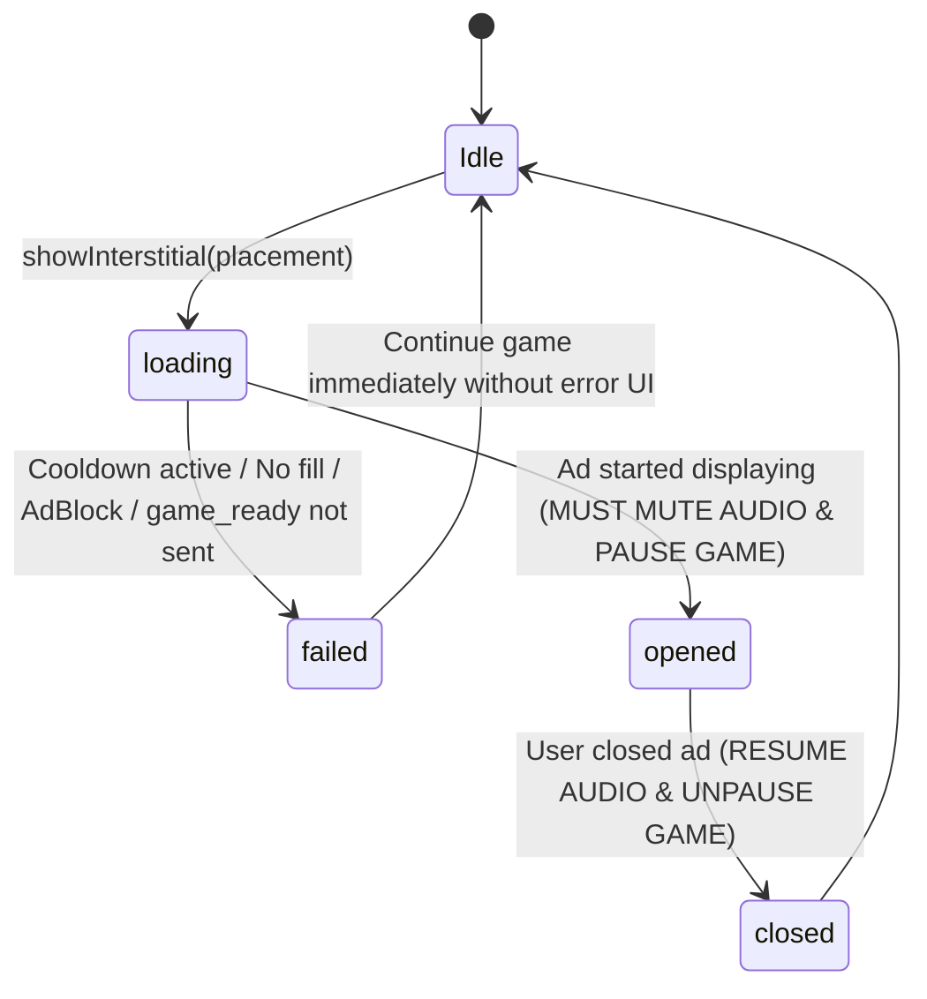
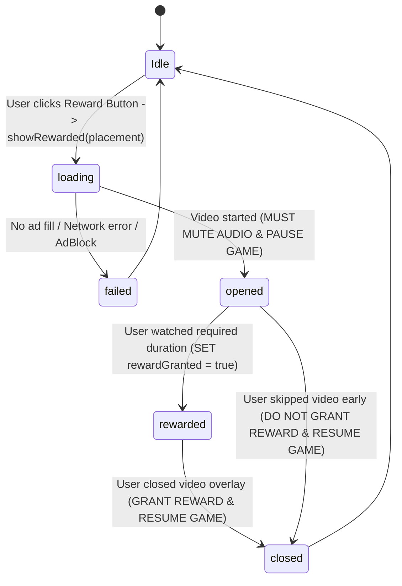

# 04. Полное руководство по рекламе и монетизации (Advertising & Monetization Guide — Deliverable C)

> **Статус документа:** `VERIFIED`  
> **Дата последней верификации:** `2026-11-08`  
> **Первичные источники:**  
> - [2. Advertising Requirements](https://wiki.playgama.com/playgama/game-requirements/advertising-requirements)  
> - [Bridge SDK — Advertisement Overview](https://wiki.playgama.com/playgama/bridge-sdk/advertisement)  
> - [Bridge SDK — Interstitial](https://wiki.playgama.com/playgama/bridge-sdk/advertisement/interstitial)  
> - [Bridge SDK — Rewarded](https://wiki.playgama.com/playgama/bridge-sdk/advertisement/rewarded)  
> - [Bridge SDK — Banner](https://wiki.playgama.com/playgama/bridge-sdk/advertisement/banner)  
> - [Bridge SDK — Advanced Banners](https://wiki.playgama.com/playgama/bridge-sdk/advertisement/advanced-banners)  
> - [Bridge SDK — AdBlock](https://wiki.playgama.com/playgama/bridge-sdk/advertisement/adblock)  
> - [Monetization Guide](https://wiki.playgama.com/playgama/guides/monetization)  
> - [In-Game Purchases Guide](https://wiki.playgama.com/playgama/guides/in-game-purchases)  
> - [Intrinsic Ads Guide (`@playgama/ads`)](https://wiki.playgama.com/playgama/guides/intrinsic-ads)  
> - [Исходный код `AdvertisementModule.ts`, `InterstitialController.ts`, `RewardedController.ts`](https://github.com/Playgama/Bridge/tree/main/src/modules/advertisement)

---

## 1. Поддерживаемые форматы монетизации в экосистеме Playgama

В экосистеме Playgama реально поддерживаются **6 рекламных и коммерческих механизмов** (`VERIFIED`):

| № | Формат | Обязательность для модерации | Статус поддержки в SDK v2.4.1 | Краткое назначение |
|---|---|---|---|---|
| 1 | **Interstitial Ads** (Межстраничная реклама) | **Mandatory (`Rule 2.1.2`)** | `bridge.advertisement.showInterstitial(placement?)` | Полноэкранная реклама в естественных паузах между игровыми сессиями/уровнями. Базовый источник дохода на всех площадках. |
| 2 | **Rewarded Ads** (Вознаграждаемая видеореклама) | **Recommended (`Rule 2.2`)** *(сильно повышает eCPM и LTV)* | `bridge.advertisement.showRewarded(placement?)` | Полноэкранный видеоролик, запускаемый строго по инициативе игрока в обмен на внутриигровой бонус (возрождение, x2 монет, бустер). |
| 3 | **Sticky Banner Ads** (Фиксированные баннеры) | Optional (`Rule 2.3`) | `bridge.advertisement.showBanner(position, placement?)` | Классический горизонтальный баннер сверху или снизу экрана (поддерживается на 11 партнёрских площадках, но **не** на `playgama` и `youtube`). |
| 4 | **Advanced Banners** (Адаптивные HTML-баннеры) | Optional (`Rule 2.3`) | `bridge.advertisement.showAdvancedBanners(placement?)` | Гибкие баннерные блоки, размеры и координаты которых задаются в `%` в `playgama-bridge-config.json` (поддерживаются на `playgama`, `msn`, `crazy_games`). |
| 5 | **Intrinsic Ads** (Внутримировая нативная реклама) | Optional (Beta / Add-on) | Отдельный пакет `@playgama/ads` (Playgama Ads Web SDK) | Рекламные билборды и постеры, вписанные непосредственно в 2D/3D-сцену игры (Three.js, PlayCanvas, PixiJS, Canvas) без прерывания геймплея. |
| 6 | **In-App Purchases (IAP)** (Внутриигровые покупки) | Optional (Mandatory для **Discord**) | `bridge.payments.purchase(id)` | Продажа внутриигровых пакетов валюты, скинов и отключений рекламы за реальные деньги или внутреннюю валюту портала. |

---

## 2. Детальный технический разбор каждого рекламного формата

### 2.1. Interstitial Ads (Межстраничная реклама — `Rules 2.1.1 – 2.1.5`)

#### Внутреннее устройство `InterstitialController.ts` (`VERIFIED` по исходному коду)
Анализ файла [`src/modules/advertisement/InterstitialController.ts`](https://github.com/Playgama/Bridge/blob/main/src/modules/advertisement/InterstitialController.ts) выявил **три критических механизма**, которые обязан знать разработчик:

1. **Блокировка до вызова `game_ready`:**
   Внутри `InterstitialController` приватное поле `#initTime` инициализируется значением `null` и устанавливается в `Date.now()` **только тогда**, когда игра вызывает `bridge.platform.sendMessage('game_ready')` (через метод `onGameReady()`). Если вызвать `showInterstitial()` до отправки `game_ready`, метод `hasInitialDelayElapsed()` возвращает `false`, и контроллер мгновенно переводит рекламу в состояние `INTERSTITIAL_STATE.FAILED` без обращения к платформе!
2. **Автоматический Cooldown и динамическая частота (`configureAdFrequency`):**
   По умолчанию минимальный интервал между показами составляет **60 секунд** (`DEFAULT_MINIMUM_DELAY = 60`). Более того, платформа Playgama может дистанционно переопределить правила показа (`initialDelay`, `cooldown`, ` filter: 'every_n'` или `'time_interval'`). Если игра вызывает `showInterstitial()` раньше истечения таймера, SDK сам безопасно отклоняет показ (`loading` → `failed`), не ломая игру.
3. **Почему запрещены кастомные таймеры в коде игры (`VERIFIED`):**
   В [FAQ — General](https://wiki.playgama.com/playgama/faq/general) и [Game Self-Check](https://wiki.playgama.com/playgama/game-requirements/game-self-check) прямо указано: **не создавайте собственные таймеры или счётчики уровней для ограничения показа Interstitial**. Вызывайте `bridge.advertisement.showInterstitial()` **на каждой логической паузе** (победа на уровне, поражение, выход в главное меню, рестарт), а контроль частоты полностью делегируйте SDK и платформе.

#### Диаграмма состояний `INTERSTITIAL_STATE`



#### Обязательные правила показа Interstitial (`Rules 2.1.x`, `VERIFIED`):
- **`2.1.1`**: Запрещено показывать Interstitial прямо во время загрузки игры (до первого геймплея) или внезапно посреди активного экшена (когда игрок управляет персонажем).
- **`2.1.2` (`Mandatory`)**: В игре обязаны быть точки вызова Interstitial в естественных переходах (завершение уровня, экран Game Over → Next/Retry, переход в меню).
- **`2.1.3`**: На время состояния `'opened'` игровой процесс и вся музыка/звуки обязаны ставиться на паузу.
- **`2.1.4`**: Если реклама перешла в `'failed'` или `'closed'`, игра обязана немедленно продолжить запланированный переход (например, загрузить следующий уровень) без показа сообщений об ошибке.

---

### 2.2. Rewarded Ads (Вознаграждаемая реклама — `Rules 2.2.1 – 2.2.6`)

#### Диаграмма состояний `REWARDED_STATE`



#### Обязательные правила показа Rewarded (`Rules 2.2.x`, `VERIFIED`):
- **`2.2.1` (Opt-in Only)**: Показ Rewarded-рекламы разрешён **только после явного нажатия игроком** на кнопку с понятной иконкой видеоролика/кинохлопушки (`TV/Video icon`) и чётким указанием награды (например, `+200 Coins` или `Revive`).
- **`2.2.2`**: Запрещено маскировать кнопку Rewarded-рекламы под обычную кнопку продолжения или подставлять её под палец игрока без задержки.
- **`2.2.3`**: Во время показа видео (`'opened'`) игра и звук должны быть на паузе.
- **`2.2.4` (Single Revive Limit)**: Если Rewarded-реклама используется для **возрождения (Revive / Second Chance)** или продолжения уровня после проигрыша, её разрешено предлагать **не более одного раза за одну попытку прохождения уровня**!
- **`2.2.5` (Strict Reward Condition)**: Награда начисляется **ТОЛЬКО** в том случае, если в течение цикла показа было получено событие `REWARDED_STATE.REWARDED` (`'rewarded'`). Если пришло `'closed'` без предшествующего `'rewarded'`, значит игрок закрыл ролик досрочно — награду выдавать запрещено.
- **`2.2.6`**: Если реклама не загрузилась (`'failed'`), кнопка награды должна корректно разблокироваться (или показать ненавязчивый тост «Video not available right now»), не блокируя дальнейшую игру.

---

### 2.3. Sticky Banner Ads и Advanced Banners (`Rules 2.3.1 – 2.3.3`)

| Характеристика | Sticky Banner (`showBanner`) | Advanced Banners (`showAdvancedBanners`) |
|---|---|---|
| **Поддерживаемые платформы** | `msn`, `microsoft_store`, `facebook`, `yandex`, `gamedistribution`, `xiaomi`, `huawei`, `samsung`, `jio_games`, `dlightek`, `ok` | `playgama`, `msn`, `crazy_games`, `qa`, `mock` |
| **Конфигурация** | Позиция передаётся в метод: `BANNER_POSITION.BOTTOM` (по умолчанию) или `BANNER_POSITION.TOP`. | Описывается в `playgama-bridge-config.json` → `advertisement.advancedBanners.placements` с фильтрацией по `devices` (`desktop`/`mobile`) и `orientations`. Все размеры и отступы задаются **строго в процентах (`%`)**. |
| **Требования к UI (`2.3.1–2.3.3`)** | Баннер **не должен перекрывать** игровые кнопки, счётчики, туториал или интерактивное поле (`Safe Area` отступ не менее `60–90 px` со стороны баннера). | Рекомендуется показывать в меню, на экране выбора уровня или по бокам на десктопе (`hideAdvancedBanners()` при входе в динамичный геймплей, если баннер мешает обзору). |

---

### 2.4. Intrinsic Ads (Внутримировая реклама — `@playgama/ads`) (`VERIFIED`)

Источник: [Intrinsic Ads Guide](https://wiki.playgama.com/playgama/guides/intrinsic-ads).
- Позволяет размещать динамические рекламные баннеры прямо на текстурах объектов внутри игрового мира (например, бортики стадиона, дорожные щиты в гонках, постеры на стенах).
- Работает поверх стандартного `Playgama Bridge` и учитывает видимость баннера в камере игрока (Viewability по стандартам IAB).
- Не прерывает игровой процесс и даёт дополнительный доход параллельно с Interstitial и Rewarded.

---

### 2.5. Проверка блокировщика рекламы (`checkAdBlock`)

```typescript
const hasAdBlock = await bridge.advertisement.checkAdBlock();
```
- **Правила использования (`VERIFIED`):** Разрешено использовать для аналитики или мягкого отключения кнопок Rewarded-рекламы, но **не рекомендуется полностью блокировать вход в игру** при обнаружении AdBlock, так как на многих площадках это расценивается модерацией как софт-лок (`Rule 1.7.1`).

---

## 3. Сводная таблица запрещённых рекламных практик (`Rules 2.1–2.5` и `3.5`)

| № | Запрещённая практика | Код правила | Статус | Последствия при обнаружении |
|---|---|---|---|---|
| 1 | Показ Interstitial во время первоначальной загрузки игры или до первого интерактивного действия игрока | `Rule 2.1.1` | `VERIFIED` | Гарантированный отказ на модерации Playgama и мгновенный бан на YouTube Playables. |
| 2 | Показ Interstitial посреди активного геймплея (во время движения/боя/таймера уровня) | `Rule 2.1.1` | `VERIFIED` | Отказ на модерации за разрушение UX. |
| 3 | Полное отсутствие вызовов `showInterstitial()` в игре | `Rule 2.1.2` | `VERIFIED` | Билд не проходит модерацию (игра не может монетизироваться). |
| 4 | Написание собственных таймеров блокировки Interstitial (например, «показывать не чаще чем раз в 5 минут»), конфликтующих с платформенным `InterstitialController` | `Game Self-Check` | `VERIFIED` | Потеря 40–70% рекламной выручки; замечание на QA. |
| 5 | Вызов `showInterstitial()` без предварительной отправки `bridge.platform.sendMessage('game_ready')` | `SDK v2.4.1 Source` | `VERIFIED` | 100% вызовов Interstitial мгновенно завершаются со статусом `'failed'` (`#initTime === null`). |
| 6 | Запуск Rewarded-рекламы автоматически без клика пользователя по кнопке с иконкой видео | `Rule 2.2.1` | `VERIFIED` | Жёсткий отказ на модерации (нарушение политики рекламных сетей Google/Meta/Yandex). |
| 7 | Предложение платного/рекламного возрождения (`Revive`) более 1 раза за одну попытку прохождения уровня | `Rule 2.2.4` | `VERIFIED` | Отказ на модерации по чеклисту `Advertising Requirements`. |
| 8 | Выдача награды по событию `'closed'` вместо `'rewarded'` (или невыдача награды после события `'rewarded'`) | `Rule 2.2.5` | `VERIFIED` | Отказ на модерации в QA Tool (модератор проверяет оба сценария: полный просмотр и досрочное закрытие). |
| 9 | Продолжение воспроизведения фоновой музыки или игровых звуков во время открытой рекламы (`'opened'`) | `Rule 2.1.3` / `3.3.5` | `VERIFIED` | Одна из самых частых причин отклонения билдов на модерации Playgama и YouTube Playables. |
| 10 | Наложение Sticky/Advanced баннера поверх кнопок управления, паузы или текста обучения | `Rule 2.3.1` | `VERIFIED` | Отказ на модерации + блокировка рекламного аккаунта за скликивание (Invalid Traffic / Accidental Clicks). |
| 11 | Мгновенное появление кнопки рекламы под пальцем игрока в момент проигрыша (Clickbait / Bait-and-Switch) | `Rule 3.5.1` | `VERIFIED` | Отказ на модерации за Dark Patterns. |

---

## 4. Производственная реализация `AdManager` на TypeScript (`@playgama/bridge@2.4.1`)

Ниже приведён полный, готовый к продакшену класс `AdManager`, который:
1. Гарантированно глушит звук и ставит игру на паузу при открытии любой рекламы.
2. Защищает игру от «вечного зависания», если сторонний рекламный скрипт на площадке не вернул финальное событие (watchdog-таймаут).
3. Строго разделяет состояния `'rewarded'` и `'closed'` по правилу `2.2.5`.
4. Контролирует лимит в 1 возрождение за попытку (`Rule 2.2.4`).

```typescript
import bridge, {
  EVENT_NAME,
  INTERSTITIAL_STATE,
  REWARDED_STATE,
  BANNER_POSITION,
   type InterstitialState,
  type RewardedState,
} from '@playgama/bridge';

export interface AdLifecycleHooks {
  onAdOpened: () => void; // Поставить геймплей на паузу и выключить звук
  onAdClosed: () => void; // Снять паузу и восстановить звук (если !bridge.platform.isPaused && bridge.platform.isAudioEnabled)
}

export class AdManager {
  private hooks: AdLifecycleHooks;
  private isAdActive = false;
  private reviveUsedInCurrentAttempt = false;

  // Колбэки текущего активного показа
  private interstitialResolver: (() => void) | null = null;
  private rewardedResolver: ((rewarded: boolean) => void) | null = null;
  private currentRewardEarned = false;

  constructor(hooks: AdLifecycleHooks) {
    this.hooks = hooks;
    this.bindEvents();
  }

  private bindEvents(): void {
    if (!bridge.isInitialized) return;

    bridge.advertisement.on(
      EVENT_NAME.INTERSTITIAL_STATE_CHANGED,
      (state: InterstitialState) => {
        switch (state) {
          case INTERSTITIAL_STATE.LOADING:
            break;
          case INTERSTITIAL_STATE.OPENED:
            this.enterAdState();
            break;
          case INTERSTITIAL_STATE.CLOSED:
          case INTERSTITIAL_STATE.FAILED:
            this.exitAdState();
            if (this.interstitialResolver) {
              const resolve = this.interstitialResolver;
              this.interstitialResolver = null;
              resolve();
            }
            break;
        }
      }
    );

    bridge.advertisement.on(
      EVENT_NAME.REWARDED_STATE_CHANGED,
      (state: RewardedState) => {
        switch (state) {
          case REWARDED_STATE.LOADING:
            this.currentRewardEarned = false;
            break;
          case REWARDED_STATE.OPENED:
            this.enterAdState();
            break;
          case REWARDED_STATE.REWARDED:
            // Правило 2.2.5: фиксируем факт заслуженной награды, но ждём закрытия окна рекламы
            this.currentRewardEarned = true;
            break;
          case REWARDED_STATE.CLOSED:
          case REWARDED_STATE.FAILED:
            this.exitAdState();
            if (this.rewardedResolver) {
              const resolve = this.rewardedResolver;
              const earned =
                state === REWARDED_STATE.CLOSED && this.currentRewardEarned;
              this.rewardedResolver = null;
              this.currentRewardEarned = false;
              resolve(earned);
            }
            break;
        }
      }
    );
  }

  private enterAdState(): void {
    if (this.isAdActive) return;
    this.isAdActive = true;
    this.hooks.onAdOpened();
  }

  private exitAdState(): void {
    if (!this.isAdActive) return;
    this.isAdActive = false;
    this.hooks.onAdClosed();
  }

  /**
   * Сбрасывать при старте каждого нового уровня/попытки (Rule 2.2.4)
   */
  public resetAttemptState(): void {
    this.reviveUsedInCurrentAttempt = false;
  }

  public canOfferRevive(): boolean {
    return (
      bridge.isInitialized &&
      bridge.advertisement.isRewardedSupported &&
      !this.reviveUsedInCurrentAttempt
    );
  }

  /**
   * Вызывать на каждой естественной паузе (Level Complete, Game Over, Exit to Menu).
   * Не требует внешних таймеров — SDK сам проверит cooldown и game_ready.
   */
  public async showInterstitial(placement = 'default'): Promise<void> {
    if (
      !bridge.isInitialized ||
      !bridge.advertisement.isInterstitialSupported ||
      this.isAdActive
    ) {
      return;
    }

    return new Promise<void>((resolve) => {
      this.interstitialResolver = resolve;
      bridge.advertisement.showInterstitial(placement).catch(() => {
        if (this.interstitialResolver) {
          this.interstitialResolver = null;
          this.exitAdState();
          resolve();
        }
      });
    });
  }

  /**
   * Вызывать только по явному клику игрока на кнопку с видео-иконкой (Rule 2.2.1).
   * Возвращает true ТОЛЬКО если было получено событие REWARDED_STATE.REWARDED.
   */
  public async showRewarded(
    placement: string,
    isRevive = false
  ): Promise<boolean> {
    if (
      !bridge.isInitialized ||
      !bridge.advertisement.isRewardedSupported ||
      this.isAdActive
    ) {
      return false;
    }

    if (isRevive && this.reviveUsedInCurrentAttempt) {
      return false; // Защита правила 2.2.4
    }

    return new Promise<boolean>((resolve) => {
      this.rewardedResolver = (earned: boolean) => {
        if (earned && isRevive) {
          this.reviveUsedInCurrentAttempt = true;
        }
        resolve(earned);
      };

      bridge.advertisement.showRewarded(placement).catch(() => {
        if (this.rewardedResolver) {
          this.rewardedResolver = null;
          this.currentRewardEarned = false;
          this.exitAdState();
          resolve(false);
        }
      });
    });
  }

  /**
   * Управление Sticky-баннером (с проверкой поддержки платформой)
   */
  public async setStickyBannerVisible(
    visible: boolean,
    position: 'top' | 'bottom' = BANNER_POSITION.BOTTOM,
    placement?: string
  ): Promise<void> {
    if (!bridge.isInitialized || !bridge.advertisement.isBannerSupported) {
      return;
    }
    if (visible) {
      await bridge.advertisement.showBanner(position, placement);
    } else {
      await bridge.advertisement.hideBanner();
    }
  }
}
```
