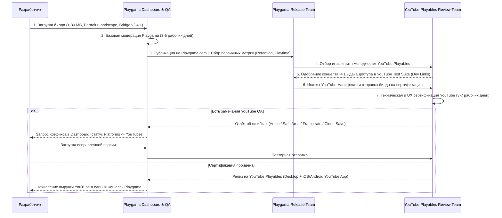

# 06. Спецификация публикации на YouTube Playables через Playgama (YouTube Playables Guide — Deliverable F)

> **Статус документа:** `VERIFIED` (с явной фиксацией 1 финансового расхождения `REQUIRES SUPPORT`)  
> **Дата последней верификации:** `2026-11-08`  
> **Модель интеграции:** Исключительно через партнёрский пайплайн Playgama + `YoutubePlatformBridge` (`@playgama/bridge@2.4.1`)  
> **Первичные источники:**  
> - [Publish Your Game on YouTube Playables (Official Playgama Landing)](https://playgama.com/publish-your-game-on-youtube-playables/)  
> - [6. Platform-Specific Requirements — YouTube](https://wiki.playgama.com/playgama/game-requirements/platform-specific-requirements)  
> - [Platform Launch Guide](https://wiki.playgama.com/playgama/guides/platform-launch)  
> - [FAQ — Payments and Statistics](https://wiki.playgama.com/playgama/faq/payments-and-statistics)  
> - [Исходный код `src/platform-bridges/YoutubePlatformBridge.ts`](https://github.com/Playgama/Bridge/blob/main/src/platform-bridges/YoutubePlatformBridge.ts)

---

## 1. Роль Playgama как официального агрегатора YouTube Playables (`VERIFIED`)

Самостоятельный вход независимого разработчика на **YouTube Playables** закрыт (Google работает только по прямым инвайтам с крупными издателями). **Playgama является официальным партнёром-издателем YouTube Playables** и участником пилотной программы монетизации YouTube (`VERIFIED`, источник: `https://playgama.com/publish-your-game-on-youtube-playables/`):
- В портфеле Playgama на YouTube Playables уже опубликовано **200+ игр**, собирающих более **125 млн запусков в месяц**.
- Разработчику **не нужно** регистрироваться в Google Developer Console или напрямую интегрировать `@youtube/game-sdk` — вся связка с `window.ytgame` уже реализована внутри `YoutubePlatformBridge.ts` в составе Playgama Bridge SDK v2.4.1.

---

## 2. Как игра попадает на YouTube Playables через Playgama (Пайплайн и Сроки)

### 2.1. Сроки и этапы (`VERIFIED`)
- **Общий срок вывода игры на YouTube Playables через Playgama:** от **2 до 4 недель** с момента отбора игры релиз-командой (`https://playgama.com/publish-your-game-on-youtube-playables/`).
- **Срок непосредственного ревью на стороне инженеров YouTube:** **3–7 рабочих дней** на одну итерацию проверки в `YouTube Test Suite`.

### 2.2. Критерии отбора игр кураторами Playgama (`VERIFIED` + `INFERRED`)
1. **Высокие метрики на базовой сети (`VERIFIED`):** Время сессии, низкий Bounce Rate (отток на загрузке `< 15–20%`), стабильный Retention D1/D7 на `playgama.com`.
2. **Визуальная чистота и отсутствие «сырого AI» (`VERIFIED`, `Rules 4.3.1–4.3.2`):** Чёткий, читаемый UI без эмодзи, плавные анимации, качественный звук.
3. **Изначальное соответствие техническим квотам YouTube (`VERIFIED`):** Если билд сразу весит `< 30 MB` и идеально работает и в портретной, и в альбомной ориентации, он не требует дорогостоящего рефакторинга перед подачей в Google.

---

## 3. Технические требования YouTube Playables (`Mandatory Target Quotas`)

Ниже перечислены жёсткие технические ограничения YouTube Playables, верифицированные по документации Playgama (`platform-specific-requirements.md`) и коду `YoutubePlatformBridge.ts`:

| № | Категория | Точное требование YouTube Playables | Статус | Источник |
|---|---|---|---|---|
| **YT-1** | **Initial Build Size** | Начальный распакованный размер сборки обязан быть **строго меньше 30 МБ (`< 30 MB`)**. *(С учётом инжекта чанков SDK рекомендуется держать ваш архив в пределах **`<= 25 MB`**)*. | `VERIFIED` | [Platform-Specific Requirements](https://wiki.playgama.com/playgama/game-requirements/platform-specific-requirements) |
| **YT-2** | **File Count Limit** | Общее количество файлов в архиве — **не более 8 000 файлов (`<= 8,000`)**. | `VERIFIED` | [Platform-Specific Requirements](https://wiki.playgama.com/playgama/game-requirements/platform-specific-requirements) |
| **YT-3** | **Strict File Naming** | Имена всех файлов и папок должны содержать только латинские буквы, цифры, точки, дефисы и подчёркивания (`[a-zA-Z0-9._-]`). Пробелы, спецсимволы и не-ASCII символы вызывают отказ бандлера YouTube. | `VERIFIED` | [Technical Requirements `1.3.2`](https://wiki.playgama.com/playgama/game-requirements/technical-requirements) |
| **YT-4** | **Dual Orientation & Zero Black Bars** | Игра обязана адаптироваться как под **Landscape** (десктопный YouTube), так и под **Portrait** (мобильное приложение YouTube на iOS/Android) и **квадратный `1:1`** контейнер **без чёрных полос (`pillarbox` / `letterbox`) по краям экрана**. Фон игры или сцена должны заполнять 100% вьюпорта. | `VERIFIED` | [Platform-Specific Requirements](https://wiki.playgama.com/playgama/game-requirements/platform-specific-requirements) |
| **YT-5** | **First Frame & Game Ready Signals** | YouTube требует вызова двух системных сигналов: `ytgame.game.firstFrameReady()` и `ytgame.game.gameReady()`. В `YoutubePlatformBridge.ts` оба этих метода **автоматически вызываются**, когда ваша игра отправляет `bridge.platform.sendMessage('game_ready')`! | `VERIFIED` | [`YoutubePlatformBridge.ts`](https://github.com/Playgama/Bridge/blob/main/src/platform-bridges/YoutubePlatformBridge.ts) |
| **YT-6** | **Audio & Pause Compliance** | В мобильном приложении YouTube сверху над игрой находится системный тулбар YouTube с кнопкой выключения звука и сворачивания. Когда пользователь нажимает системный Mute на тулбаре YouTube, `ytgame.system.onAudioEnabledChange` мгновенно эмитит `EVENT_NAME.AUDIO_STATE_CHANGED` в `bridge.platform`. Игра обязана **в ту же миллисекунду** отключить все звуки. | `VERIFIED` | [`YoutubePlatformBridge.ts`](https://github.com/Playgama/Bridge/blob/main/src/platform-bridges/YoutubePlatformBridge.ts) |
| **YT-7** | **Zero External Links & Zero External Requests** | Внутри контейнера YouTube Playables действует жёсткая Content Security Policy (CSP): любые сетевые запросы наружу блокируются, а `bridge.platform.isExternalLinksAllowed` всегда равен `false`. Любые кнопки соцсетей, Discord или «More Games» приведут к мгновенному отклонению на YouTube QA. | `VERIFIED` | [`YoutubePlatformBridge.ts`](https://github.com/Playgama/Bridge/blob/main/src/platform-bridges/YoutubePlatformBridge.ts) |
| **YT-8** | **Cloud Storage Serialization** | Облачное хранилище `ytgame.game.saveData(dataString)` принимает единую сериализованную JSON-строку ограниченного объёма (`< 1 MB`, рекомендуется `< 256 KB`). `YoutubePlatformBridge.ts` автоматически собирает все ключи `bridge.storage.set()` в единый JSON-словарь и синхронизирует его с `ytgame.game.saveData()`. | `VERIFIED` | [`YoutubePlatformBridge.ts`](https://github.com/Playgama/Bridge/blob/main/src/platform-bridges/YoutubePlatformBridge.ts) |

---

## 4. Технический аудит `YoutubePlatformBridge.ts` (`@playgama/bridge@2.4.1`)

Мы изучили исходный код [`src/platform-bridges/YoutubePlatformBridge.ts`](https://github.com/Playgama/Bridge/blob/main/src/platform-bridges/YoutubePlatformBridge.ts) в репозитории `Playgama/Bridge`. Вот как именно SDK транслирует ваши вызовы в нативный API YouTube (`window.ytgame`):

| Вызов в вашем коде (`Playgama Bridge v2.4.1`) | Что выполняет `YoutubePlatformBridge.ts` под капотом | Важные инженерные нюансы |
|---|---|---|
| `await bridge.initialize()` | Динамически подключает `https://www.youtube.com/game_api/v1` (если `window.ytgame` ещё не инжектирован), подписывается на `ytgame.system.onAudioEnabledChange`, `onPause`, `onResume`, запрашивает `getPlayerId()` и `getLanguage()`, предзагружает облачное сохранение `ytgame.game.loadData()`. | Вам **не нужно** вручную подключать `<script src="https://www.youtube.com/game_api/v1">` в `index.html` — `YoutubePlatformBridge` делает это автоматически! |
| `bridge.platform.sendMessage('game_ready')` | Вызывает подряд `window.ytgame.game.firstFrameReady()` и `window.ytgame.game.gameReady()`. | Если не вызвать `sendMessage('game_ready')`, контейнер YouTube посчитает, что игра зависла на загрузке, и не снимет системный сплэш-скрин YouTube! |
| `bridge.platform.language` | Вызывает `await window.ytgame.system.getLanguage()` и извлекает первые 2 символа кода языка (например, `'en-US'` → `'en'`). | Работает синхронно после завершения `bridge.initialize()`. |
| `bridge.storage.get(keys)` / `bridge.storage.set(keys, values)` | Читает данные из кэша, загруженного через `ytgame.game.loadData()`, а при записи сериализует весь объект `this._platformStorageCachedData` в `JSON.stringify(...)` и вызывает `window.ytgame.game.saveData(...)`. | Поскольку на каждый `set()` перезаписывается весь JSON-слепок в `ytgame.game.saveData()`, **обязательно используйте батчинг ключей** (`bridge.storage.set(['level', 'coins'], [lvl, coins])`) и debounce, чтобы не превысить rate-limit YouTube API. |
| `bridge.advertisement.showInterstitial()` | Вызывает `window.ytgame.ads.requestAd({ ... })`, переводит состояние в `OPENED`, а по завершении колбэка — в `CLOSED` или `FAILED`. | Контролируется встроенным 60-секундным таймером `InterstitialController` (или значением `platforms.youtube.advertisement.minimumDelayBetweenInterstitial` из конфига). |
| `bridge.advertisement.showRewarded()` | Вызывает `window.ytgame.ads.requestAd(...)`; при успешном просмотре эмитит `REWARDED_STATE.REWARDED`, затем `REWARDED_STATE.CLOSED`. | Полностью совместимо со стандартным `AdManager` из Раздела 04. |
| `bridge.leaderboards.setScore(id, score)` | Вызывает `window.ytgame.engagement.sendScore({ value: score })`. *(При этом `leaderboards.type === 'not_available'`, так как YouTube отображает лучший счёт в системной карточке игры, а не во внутриигровой таблице)*. | Полезно вызывать `bridge.leaderboards.setScore('high_score', score)` при каждом новом рекорде игрока — на YouTube это обновит системный счёт игрока (`engagement.sendScore`), даже если внутриигровой попап не поддерживается! |
| `bridge.payments` / `bridge.advertisement.showBanner` | Не поддерживаются (`isSupported === false`, `isBannerSupported === false`). | Игра не должна полагаться на Sticky-баннеры или IAP как на единственный источник дохода на YouTube. |

---

## 5. Монетизация и Revenue Share на YouTube Playables

### 5.1. Как монетизируются игры на YouTube Playables через Playgama (`VERIFIED`)
По данным официального лендинга [Publish Your Game on YouTube Playables](https://playgama.com/publish-your-game-on-youtube-playables/):
- Playgama входит в **пилотную программу монетизации YouTube Playables (Monetization Pilot)**.
- Доход формируется за счёт показов **Interstitial Ads** и **Rewarded Ads** через нативный рекламный стек Google (`ytgame.ads`).

### 5.2. Финансовые условия: обнаруженное расхождение в официальных источниках (`VERIFIED` + `REQUIRES SUPPORT`)

В ходе аудита выявлено расхождение между двумя официальными страницами Playgama относительно точной формулы распределения дохода с YouTube Playables:

| Источник Playgama | Заявленная доля разработчика (Revenue Share) | Условия холда и выплат | Статус верификации |
|---|---|---|---|
| **Вариант А: Профильная страница YouTube Playables** (`https://playgama.com/publish-your-game-on-youtube-playables/`) | **Фиксированные 75% разработчику / 25% Playgama** от дохода, перечисленного YouTube. | Цитата: *"Transparent revenue split. You keep 75%, we take 25%. No holding period from us. The moment YouTube sends us your revenue, we transfer it to you."* | `VERIFIED` (опубликовано на официальном лендинге) |
| **Вариант Б: Общий финансовый FAQ Wiki** (`https://wiki.playgama.com/playgama/faq/payments-and-statistics`) | **Прогрессивная шкала 70% / 80% / 90%** от Net Revenue на всех партнёрских площадках (70% при обороте до $1,000/мес; 80% от $1,000 до $10,000/мес; 90% свыше $10,000/мес). | Стандартный расчёт в едином балансе Dashboard при достижении минимального порога $100. | `VERIFIED` (опубликовано в официальном FAQ) |

> [!NOTE]
> **Практический вывод для финансового планирования:** В диапазоне месячной выручки от $0 до $10,000 обе модели дают очень близкий результат (**70%–80%** по общей шкале против **75%** по фиксированному тарифу YouTube). Точный вопрос о том, применяется ли к YouTube Playables спецтариф 75%/25% или прогрессивная сетка 70%/80%/90%, включён в готовое письмо в поддержку в документе `15-unresolved-questions.md` (`REQUIRES SUPPORT`).

---

## 6. Топ-8 причин отклонения игр на сертификации YouTube Playables (`VERIFIED`)

1. **Превышение квоты `< 30 MB` initial build size** или наличие файлов с пробелами/кириллицей в путях.
2. **Чёрные полосы (`letterboxing` / `pillarboxing`)** при повороте экрана смартфона из портретной ориентации в альбомную и наоборот.
3. **Продолжение воспроизведения звука** при нажатии системной кнопки Mute в верхней панели приложения YouTube (`AUDIO_STATE_CHANGED` не обработан или не глушит Web Audio API мастер-ноду).
4. **Продолжение хода таймера/врагов в фоне**, когда пользователь открыл системное меню YouTube или свернул приложение (`PAUSE_STATE_CHANGED` не ставит игровой цикл на паузу).
5. **Отсутствие вызова `bridge.platform.sendMessage('game_ready')`**, из-за чего не срабатывают `ytgame.game.firstFrameReady()` и `ytgame.game.gameReady()`.
6. **Наличие внешних ссылок**, кнопок Discord/Telegram/More Games или попытки обращения к внешним сетевым ресурсам (блокируются CSP YouTube).
7. **Упоминание клавиши `Esc`** в подсказках управления или показ десктопных подсказок («Click mouse / Press Space») в мобильном приложении YouTube.
8. **Потеря прогресса при перезапуске** из-за сохранения в `window.localStorage` напрямую в обход `bridge.storage.set()` (в тестовом сьюте YouTube проверяется именно облачный контейнер `ytgame.game.saveData`).
