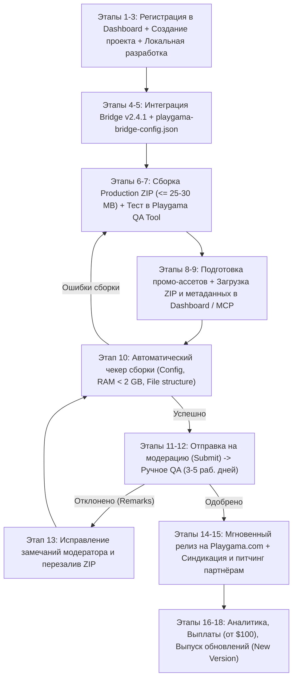

# 07. Пошаговый регламент публикации игры через Playgama (Publishing Workflow — Deliverable D)

> **Статус документа:** `VERIFIED`  
> **Дата последней верификации:** `2026-11-08`  
> **Первичные источники:**  
> - [Quick Start](https://wiki.playgama.com/playgama/quick-start)  
> - [Submitting a Game](https://wiki.playgama.com/playgama/submitting-a-game)  
> - [Game Self-Check](https://wiki.playgama.com/playgama/game-requirements/game-self-check)  
> - [FAQ — Submitting a Game](https://wiki.playgama.com/playgama/faq/submitting-a-game)  
> - [FAQ — Game Moderation](https://wiki.playgama.com/playgama/faq/game-moderation)  
> - [Playgama MCP Server & Tools](https://wiki.playgama.com/playgama/mcp/tools)

---

## 1. Общая схема процесса публикации (Deliverable D)

Публикация игры в экосистеме Playgama может выполняться двумя полностью совместимыми способами:
1. **Через веб-интерфейс Playgama Developer Dashboard (`https://developer.playgama.com`)** — классический визуальный путь.
2. **Через официальный Playgama MCP Server (`https://developer.playgama.com/api/mcp`)** — автоматизированная загрузка билда, ассетов, метаданных и отправка на модерацию прямо из IDE / терминала.

---

## 2. Детальный пошаговый регламент (Шаги 1 – 18)

### Этап 1. Регистрация аккаунта разработчика (`VERIFIED`)
1. Перейдите на [https://developer.playgama.com](https://developer.playgama.com) и создайте аккаунт разработчика (поддерживается регистрация по email или через OAuth).
2. Примите условия [Developer Terms & License Agreement](https://developer.playgama.com/terms).
3. *(Опционально для автоматизации)* В настройках профиля сгенерируйте **Personal Access Token (PAT)** или подключите MCP через OAuth к `https://developer.playgama.com/api/mcp`.

### Этап 2. Подготовка карточки проекта и выбор жанров/тегов (`VERIFIED`)
1. В Dashboard нажмите **Add Game** (или вызовите MCP-инструмент `create_game`).
2. Выберите основной жанр (допускается 1–2 жанра из системного справочника `get_genres`) и релевантные теги (`get_tags`).
3. Укажите поддерживаемые ориентации экрана (`Landscape`, `Portrait` или обе — рекомендуется обе для YouTube Playables) и целевые устройства (`Desktop`, `Mobile`).

### Этап 3. Разработка игры с учётом «Золотого стандарта» квот (`VERIFIED`)
Проектируйте билд сразу под самые строгие партнёрские лимиты (см. `02-technical-requirements.md` и `05-partner-distribution.md`):
- Суммарный распакованный размер — **`<= 25–30 MB`** (квота YouTube Playables `< 30 MB`, базовая квота Playgama `<= 300 MB`).
- Количество файлов — **`<= 250–500`** (квота Facebook Gaming `<= 500`, квота YouTube `<= 8,000`).
- Поддержка квадратного окна **`1:1`** (`Rule 1.6.8`) и отсутствие чёрных полос при смене ориентации.
- Отказ от клавиши `Esc` (`Rule 1.5.2`), внешних ссылок (`Rule 1.2.6`), сторонней аналитики (`Rule 1.2.4`) и процедурно синтезированного звука (`Rule 3.3.2`).

### Этап 4. Интеграция Playgama Bridge SDK (`v2.4.1`) (`VERIFIED`)
1. Подключите `@playgama/bridge@2.4.1` (через CDN `https://bridge.playgama.com/v2/stable/playgama-bridge.js` или Vite-плагин `@playgama/bridge/vite`).
2. Реализуйте обязательную связку:
   - `await bridge.initialize()`;
   - чтение `bridge.platform.language`, `bridge.platform.isAudioEnabled`, `bridge.platform.isPaused`;
   - подписка на `PAUSE_STATE_CHANGED` и `AUDIO_STATE_CHANGED`;
   - сохранение/загрузка прогресса через `bridge.storage.get()` / `bridge.storage.set()`;
   - вызов `await bridge.platform.sendMessage('game_ready')` сразу после готовности первого интерактивного экрана;
   - вызов `bridge.advertisement.showInterstitial()` на каждой естественной паузе (без кастомных таймеров!) и `showRewarded()` по клику на кнопки наград.

### Этап 5. Настройка `playgama-bridge-config.json` (`VERIFIED`)
1. Разместите валидный `playgama-bridge-config.json` в корне проекта рядом с `index.html` (`Rule 1.1.1`).
2. Проверьте, что `"forciblySetPlatformId"` пуст (`""`) или удалён, `"sendAnalyticsEvents": true`, `"disableBrowserDefaults": true`.
3. Опишите плейсменты рекламы (`interstitial`, `rewarded`, `advancedBanners`), таблицы лидеров и товары IAP (если используются).

### Этап 6. Сборка Production ZIP-архива (`VERIFIED`)
1. Выполните продакшен-сборку (`npm run build`).
2. Убедитесь, что `index.html` и `playgama-bridge-config.json` лежат **непосредственно в корне архива** (а не внутри вложенной папки `dist/` внутри `.zip`!).
3. Проверьте все пути в `index.html`: они должны быть строго относительными (`./assets/...`), а имена всех файлов содержать только символы `[a-zA-Z0-9._-]`.

### Этап 7. Локальное тестирование и проверка в Playgama QA Tool (`VERIFIED`)
1. Откройте [https://bridge.playgama.com](https://bridge.playgama.com) (официальный **Playgama QA Tool**).
2. Загрузите собранный ZIP-архив и проверьте по чеклисту `game-self-check`:
   - В логе QA Tool появился сигнал `game_ready`.
   - Тумблеры `Pause` и `Audio` в панели QA Tool мгновенно ставят игру на паузу и выключают/включают звук.
   - Кнопки тестового вызова `Interstitial` и `Rewarded` глушат звук на время состояния `opened`, корректно выдают награду при `rewarded` и **не** выдают её при досрочном закрытии (`closed` без `rewarded`).
   - Перезагрузка страницы сохраняет прогресс через `storage`.

### Этап 8. Подготовка обязательных и рекомендуемых промо-материалов (`VERIFIED`)
Подготовьте маркетинговые материалы согласно требованиям витрины ([Submitting a Game](https://wiki.playgama.com/playgama/submitting-a-game), [MCP Tools — `upload_asset`](https://wiki.playgama.com/playgama/mcp/tools)):

| Тип ассета | Технические параметры | Обязательность | Примечание |
|---|---|---|---|
| **Квадратная иконка (`Icon`)** | `512 × 512 px`, PNG / JPG / WebP | **Mandatory** | Крупный читаемый силуэт персонажа/объекта без мелкого текста. |
| **Горизонтальная обложка (`Cover / Landscape`)** | `800 × 500 px` (или `1920 × 1080 px`), PNG / JPG / WebP | **Mandatory** | Используется на `playgama.com`, MSN и десктопных витринах. |
| **Вертикальная обложка (`Portrait Cover`)** | `600 × 900 px` (или `500 × 800 px`), PNG / JPG / WebP | **Recommended** (Mandatory для ряда мобильных витрин) | Повышает CTR в мобильных каталогах. |
| **Скриншоты геймплея (`Screenshots`)** | Минимум **2–5 скриншотов** реального геймплея (Landscape и/или Portrait) | **Mandatory** | Должны отражать реальный игровой процесс без фейкового UI. |
| **Видео геймплея (`Gameplay Video / Trailer`)** | `.mp4`, длительность 15–30 сек, реальный захват экрана | **Strongly Recommended** | Используется для превью при наведении курсора на карточку игры (Hover Preview) — кратно увеличивает CTR! |
| **Описание и Инструкция (`Description & Controls`)** | Название игры, краткое описание геймплея и описание управления на английском языке (`en`, + опционально `ru` и др.) | **Mandatory** | Заполняется в карточке версии игры. |

### Этап 9. Загрузка билда и ассетов в Playgama Dashboard (или через MCP) (`VERIFIED`)
- **Через Dashboard UI:** Перейдите во вкладку версии игры, загрузите ZIP-архив, обложки, скриншоты и заполните текстовые поля.
- **Через Playgama MCP Server:** Вызовите `upload_build(gameId, versionId, filePath)`, `upload_asset(...)` и `update_game_version(...)`.

### Этап 10. Прохождение автоматической валидации сборки (`Automated Build Check`) (`VERIFIED`)
Сразу после загрузки ZIP-файла сервер Playgama запускает автоматический анализатор ([Submitting a Game](https://wiki.playgama.com/playgama/submitting-a-game)):
- Проверяет наличие `index.html` и валидность `playgama-bridge-config.json`.
- Запускает игру в headless-браузере и замеряет пиковое потребление ОЗУ (должно быть **`< 2 GB`** по правилу `1.3.3`) и отсутствие фатальных ошибок инициализации.
- Формирует закрытую ссылку предпросмотра (`Preview Link`), по которой разработчик должен открыть игру на ПК и смартфоне для финальной проверки в боевом контейнере Playgama.

### Этап 11. Отправка на модерацию (`Submit for Moderation`) (`VERIFIED`)
Нажмите кнопку **Submit for Moderation** в Dashboard (или вызовите MCP-инструмент `submit_game_version`). Статус версии изменится на `Under Moderation / In Review`.

### Этап 12. Прохождение ручной модерации Playgama (3–5 рабочих дней) (`VERIFIED`)
Команда QA и модерации Playgama вручную тестирует игру на соответствие всем правилам `1.1–5.1` ([FAQ — Game Moderation](https://wiki.playgama.com/playgama/faq/game-moderation)):
- Стандартный срок рассмотрения составляет **от 3 до 5 рабочих дней**.

### Этап 13. Отработка замечаний модератора (при статусе `Rejected / Needs Changes`) (`VERIFIED`)
Если модератор обнаружил нарушения (например, звук не выключается при открытии рекламы или не поддерживается окно `1:1`):
1. В Dashboard и на email приходит детальный список замечаний со ссылками на пункты правил и скриншотами/видео ошибки.
2. Вы вносите исправления в код, собираете новый ZIP, загружаете его в ту же версию и повторно нажимаете **Submit for Moderation**. Количество итераций исправлений не ограничено.

### Этап 14. Публикация на Playgama.com и собственной iframe-сети (`VERIFIED`)
Сразу после получения статуса `Approved / Published`:
- Игра становится публично доступной на `https://playgama.com` и автоматически попадает в каталог дистрибуции для **100+ партнёрских сайтов**.
- С первой минуты начинается показ рекламы и начисление **50% Net Revenue** с собственной сети Playgama.

### Этап 15. Дистрибуция и сертификация на партнёрских площадках (`Platforms Tab`) (`VERIFIED`)
1. Откройте вкладку **Platforms** в карточке игры в Dashboard ([Platform Launch Guide](https://wiki.playgama.com/playgama/guides/platform-launch)).
2. Релиз-менеджеры Playgama подают игру в открытые каталоги (Yandex/Playhop, GameDistribution, Xiaomi, Y8, Lagged, Huawei и др.) и питчат лучшие тайтлы на курируемые площадки (**YouTube Playables**, **MSN**, **Facebook Gaming**, **GameSnacks**).
3. Если конкретная площадка (например, YouTube Playables или Xiaomi) запрашивает специфическую доработку, статус этой площадки во вкладке **Platforms** отобразит комментарий QA — после загрузки новой версии игры Playgama отправит обновление партнёру.

### Этап 16. Мониторинг аналитики и оптимизация метрик (`VERIFIED`)
Используйте раздел **Analytics** в Dashboard (или MCP-инструмент `get_games_analytics`) для отслеживания:
- Конверсии загрузки (`Bounces` и воронки `GameplayMilestoneTracker`: `0s → 30s → 60s → 120s → 300s → 600s`).
- Выручки (`Revenue`), показов (`Impressions`) и `Retention` в разрезе каждой площадки.

### Этап 17. Вывод дохода (`Payouts`) (`VERIFIED`)
При накоплении на балансе кошелька суммы от **$100 USD** создайте заявку на выплату в разделе **Balance / Payouts** (банковским переводом или в криптовалюте по согласованию с поддержкой; актуальные условия — в [Payments FAQ](https://wiki.playgama.com/playgama/faq/payments-and-statistics)).

### Этап 18. Выпуск обновлений или снятие игры с публикации (`VERIFIED`)
- **Обновление:** Нажмите **Create New Version** (`create_new_game_version` в MCP). Текущая версия продолжит работать и приносить доход, пока новая версия проходит модерацию (`12-updates-and-maintenance.md`).
- **Удаление:** Отправьте запрос в поддержку (`developer.success@playgama.com`) для депубликации игры с витрины Playgama и партнёрских площадок.
