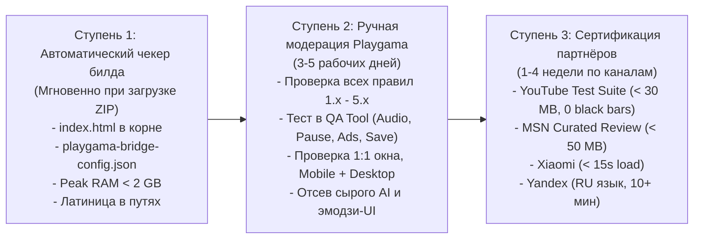

# 08. Оценка качества, модерация и методология QA (Moderation & QA Audit)

> **Статус документа:** `VERIFIED`  
> **Дата последней верификации:** `2026-11-08`  
> **Первичные источники:**  
> - [7. Game Self-Check](https://wiki.playgama.com/playgama/game-requirements/game-self-check)  
> - [FAQ — Game Moderation](https://wiki.playgama.com/playgama/faq/game-moderation)  
> - [How to Fix Issues — Audio Issues](https://wiki.playgama.com/playgama/how-to-fix-issues/audio-issues)  
> - [How to Fix Issues — Adaptive Layout](https://wiki.playgama.com/playgama/how-to-fix-issues/adaptive-layout)  
> - [How to Fix Issues — Browser Defaults](https://wiki.playgama.com/playgama/how-to-fix-issues/browser-defaults)  
> - [How to Fix Issues — Saving Progress](https://wiki.playgama.com/playgama/how-to-fix-issues/saving-progress)  
> - [Playgama QA Tool (`https://bridge.playgama.com`)](https://bridge.playgama.com)

---

## 1. Как устроена трёхступенчатая система контроля качества в Playgama (`VERIFIED`)

Каждая игра, загружаемая в Playgama Developer Dashboard, проходит три последовательных фильтра перед выходом на все каналы дистрибуции:

### 1.1. Что оценивают модераторы на Ступени 2 (`VERIFIED`)
1. **Безупречность интеграции SDK (`Rules 1.1.x`, `2.x`, `3.3.x`):** Модератор открывает билд в тестовом контейнере и принудительно нажимает кнопки симуляции паузы, отключения звука, вызова Interstitial, полного просмотра Rewarded и досрочного закрытия Rewarded. Любой фоновый звук при открытой рекламе или свёрнутой вкладке — мгновенный возврат на доработку.
2. **Кроссплатформенность и адаптивность (`Rules 1.4–1.6`):** Игра запускается сначала на десктопе (проверка мыши, клавиатуры, запрета клавиши `Esc`, отсутствия скролла страницы), затем на смартфоне (проверка тачей, мультитача, отсутствия выделения текста и контекстного меню при зажатии пальца) и в квадратном окне **`1:1`**.
3. **Художественное и продуктовое качество (`Rules 3.1–3.4`, `4.3`):** Наличие визуального лоадера, понятного обучения на первом уровне, качественных звуковых файлов (запрет процедурных `AudioContext` писков по правилу `3.3.2`) и целостного UI без системных эмодзи и следов шаблонной AI-генерации (`Rules 4.3.1–4.3.2`).

---

## 2. Руководство по работе с Playgama QA Tool (`https://bridge.playgama.com`)

Официальный инструмент самопроверки [https://bridge.playgama.com](https://bridge.playgama.com) позволяет разработчику прогнать билд ровно по тому же сценарию, который использует команда модерации Playgama (`VERIFIED`, источник: [Quick Start](https://wiki.playgama.com/playgama/quick-start)).

### 2.1. Два режима запуска QA Tool
1. **Через веб-песочницу `https://bridge.playgama.com`:** перетащите собранный `.zip` архив игры в окно браузера — песочница распакует архив, запустит игру во встроенном `iframe` и откроет боковую панель инспектора событий.
2. **Локально в процессе разработки (`localhost`):** добавьте параметр `?platform_id=qa` к локальному URL (например, `http://localhost:5173/?platform_id=qa`). SDK инициализирует мост `QaPlatformBridge`, который выводит события и позволяет тестировать API без упаковки в ZIP.

### 2.2. Что обязательно проверить в панели Playgama QA Tool перед сабмитом
1. **Инспектор инициализации:** убедитесь, что статус `bridge.initialize` — `Success`, а сразу после появления главного меню или 1-го уровня в логе фиксируется `platform.sendMessage('game_ready')`.
2. **Тумблер `Audio State`:** переключите `isAudioEnabled` в `false` — вся музыка и SFX в игре должны мгновенно замолчать. Переключите обратно в `true` — звук должен восстановиться (если пользователь сам не выключил звук внутриигровой кнопкой Mute).
3. **Тумблер `Pause State`:** переключите `isPaused` в `true` — игровой мир, таймеры, физика и звук должны остановиться.
4. **Симулятор `Interstitial` и `Rewarded`:**
   - Пройдите уровень → убедитесь, что игра вызвала `advertisement.showInterstitial()`.
   - Нажмите кнопку награды → в QA Tool выберите сценарий **Close without reward** (убедитесь, что награда **не** начислилась), затем вызовите повторно и выберите **Grant reward & close** (убедитесь, что награда начислилась ровно 1 раз).
5. **Инспектор `Storage`:** проверьте, какие ключи и значения игра записывает через `bridge.storage.set()`, и убедитесь, что при перезагрузке фрейма игра считывает их через `bridge.storage.get()`.

---

## 3. Сводная таблица причин отклонения на модерации и методов их тестирования

| Requirement (Требование и код правила) | Mandatory or Recommended | Reason for Rejection (Типичная причина отказа на модерации) | How to Test (Точная методика проверки до отправки) |
|---|---|---|---|
| **Наличие и валидность `playgama-bridge-config.json` (`1.1.1`)** | **Mandatory** | Файл отсутствует в корне архива, содержит синтаксическую ошибку JSON или оставлен `"forciblySetPlatformId": "mock"`. | Открыть собранный `.zip`, проверить наличие `playgama-bridge-config.json` рядом с `index.html`, прогнать через `JSON.parse()` и убедиться, что `forciblySetPlatformId` пуст. |
| **Отправка сигнала `game_ready` (`1.1.2`)** | **Mandatory** | Игра не вызывает `bridge.platform.sendMessage('game_ready')` (или вызывает его слишком рано — до загрузки ассетов). Кроме того, без `game_ready` не работает `InterstitialController`! | Загрузить ZIP на `https://bridge.playgama.com` и убедиться, что событие `game_ready` загорается зелёным ровно в момент появления интерактивного экрана. |
| **Сохранение прогресса через `bridge.storage` (`1.1.3`)** | **Mandatory** | Игра сохраняет данные напрямую в `window.localStorage` в обход `bridge.storage.set()`, либо теряет прогресс после перезагрузки страницы. | Пройти 1–2 уровня, купить апгрейд, изменить настройку звука, перезагрузить страницу в QA Tool и проверить, что все данные восстановились, а в логе QA Tool видны вызовы `storage.set` и `storage.get`. |
| **Отсутствие обязательной регистрации и внешних ссылок (`1.2.1`, `1.2.6`)** | **Mandatory** | Игра требует логина перед стартом, либо на сплэш-скрине / в меню есть кликабельный логотип студии, ссылка на Discord, Telegram или «More Games» при `isExternalLinksAllowed === false`. | Проверить все экраны игры: при `bridge.platform.isExternalLinksAllowed === false` (дефолт на Playgama и YouTube) в UI не должно быть ни одной внешней ссылки или кликабельного баннера. |
| **Полная автономность билда и отсутствие внешней аналитики (`1.2.4`, `1.2.5`)** | **Mandatory** | Игра подгружает Google Fonts (`fonts.googleapis.com`), внешние CDN-библиотеки, картинки со стороннего сервера или отправляет хиты в Google Analytics / Firebase / Yandex Metrica. | Открыть Chrome DevTools → **Network**, перезагрузить игру с `Disable cache` и отфильтровать запросы по сторонним доменам (разрешён только `bridge.playgama.com`). |
| **Лимиты сборки и именование файлов (`1.3.1–1.3.3`)** | **Mandatory** | `index.html` вложен в подпапку внутри ZIP; в именах файлов есть пробелы или кириллица; размер распакованного билда `> 300 MB` (`> 30 MB` для YouTube); пик RAM при старте `>= 2 GB`. | Запустить скрипт `validate-release.mjs` (см. `13-technical-architecture.md`): проверить корневой `index.html`, регулярное выражение `^[a-zA-Z0-9._/-]+$`, общий размер `< 25–30 MB` и память в Chrome Task Manager `< 500 MB`. |
| **Адаптация управления под Desktop и Mobile (`1.4.1–1.4.4`)** | **Mandatory** | На смартфоне пишутся подсказки «Press Space / WASD / Click mouse»; на десктопе не работает мышь; не работает мультитач (одновременный бег и прыжок). | Проверить ветвление UI по `bridge.device.type`; протестировать игру в мобильном режиме DevTools и на реальном смартфоне двумя пальцами одновременно. |
| **Подавление системных жестов браузера (`1.4.5`, `1.5.1`)** | **Mandatory** | При долгом нажатии пальцем на экран появляется выделение текста, лупа iOS или контекстное меню «Сохранить изображение»; нажатие `Space` или стрелок скроллит страницу портала. | Зажать палец на 3 секунды на экране iOS/Android и нажать правую кнопку мыши на канвасе; нажать `Space` и `ArrowDown` внутри `iframe`. |
| **Запрет клавиши `Esc` (`1.5.2`)** | **Mandatory** | Клавиша `Esc` назначена на паузу или выход в меню (конфликтует с выходом браузера из полноэкранного режима). | Нажать `Esc` во время уровня и в меню: игра не должна перехватывать `Escape` (для паузы использовать кнопку UI или клавишу `P`). |
| **Адаптивная вёрстка и квадратное окно `1:1` (`1.6.1–1.6.8`)** | **Mandatory** | При ресайзе окна канвас обрезается, появляются скроллбары браузера, а в пропорции **`1:1` (квадрат `600×600`)** кнопки UI налезают друг на друга или выходят за экран. | Протестировать игру в DevTools при разрешениях `1920×1080` (`16:9`), `375×812` (`9:16`), `768×1024` (`3:4`) и обязательно **`600×600` (`1:1`)**, плавно меняя ширину и высоту окна мышью. |
| **Правила показа Interstitial и Rewarded рекламы (`2.1.1–2.2.6`)** | **Mandatory** | Нет вызовов `showInterstitial()`; Interstitial вызывается во время загрузки или посреди боя; награда за Rewarded выдаётся по событию `closed` при досрочном закрытии; возрождение (`Revive`) предлагается больше 1 раза за попытку. | Проверить все точки вызова рекламы в QA Tool: полный просмотр Rewarded, досрочное закрытие Rewarded, ошибку загрузки (`failed`) и однократность кнопки `Revive`. |
| **Наличие и качество звука, запрет процедурных писков (`3.3.1–3.3.3`)** | **Mandatory** | В игре нет музыки или SFX; вместо аудиофайлов используются процедурно сгенерированные кодом звуки (`AudioContext.createOscillator()`); отсутствует кнопка выключения звука в UI. | Убедиться, что все BGM и SFX лежат как `.mp3`/`.ogg` файлы в `assets/audio/`, а в HUD есть рабочая кнопка Mute/Unmute. |
| **Жизненный цикл звука при рекламе, паузе и сворачивании вкладки (`3.3.4–3.3.5`)** | **Mandatory** | Музыка продолжает играть поверх открытой рекламы (`INTERSTITIAL_STATE.OPENED` / `REWARDED_STATE.OPENED`), при сворачивании браузера на мобильном или при `bridge.platform.isPaused === true`. | Проверить 4 сценария: 1) открытие Interstitial/Rewarded, 2) переключение вкладки браузера (`Ctrl+Tab`), 3) блокировка экрана смартфона, 4) тумблер `Audio`/`Pause` в QA Tool. Во всех 4 случаях должен наступать 100% тишина. |
| **Запрет «сырого AI» и эмодзи в UI (`4.3.1–4.3.2`)** | **Mandatory** | Использование системных эмодзи (`🪙`, `🔊`, `⚙️`, `❤️`) вместорисованных иконок, стандартные градиентные HTML-плашки из промптов LLM, визуально несочетающиеся спрайты с артефактами генерации. | Визуальный ревью всех экранов: 100% иконок должны быть выполнены в едином графическом стиле (SVG / PNG-атлас), 0 символов Unicode-эмодзи в вёрстке и канвасе. |
| **Локализация и автоопределение языка (`5.1.1–5.1.3`)** | **Mandatory** | Отсутствует английский язык (`en`), либо игра не считывает `bridge.platform.language` при запуске и требует ручного переключения языка, либо на экране смешаны строки на разных языках. | Запустить игру с параметрами `?language=en` и `?language=ru` в QA Tool — интерфейс должен автоматически загружаться на выбранном языке без непереведённых ключей. |
| **Целевые метрики производительности (`PERF-1`–`PERF-6`)** | **Recommended** *(Mandatory для отбора в YouTube / Xiaomi)* | Слишком долгая загрузка (`> 10–15 сек`), падение FPS ниже 30 на смартфонах, краш на iOS Safari из-за нехватки видеопамяти под несжатые 4K текстуры. | Профиль `Fast 4G` + `CPU 4x slowdown` в Chrome DevTools: загрузка `< 4–5 сек`, FPS `>= 50–60`, RAM `< 300–500 MB`. |
