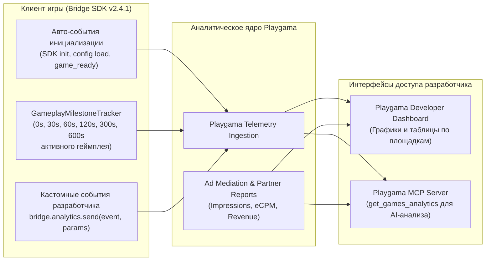

# 11. Аналитика, телеметрия и оптимизация воронки (Analytics & Telemetry)

> **Статус документа:** `VERIFIED`  
> **Дата последней верификации:** `2026-11-08`  
> **Первичные источники:**  
> - [Bridge SDK — Analytics Module](https://wiki.playgama.com/playgama/bridge-sdk/analytics)  
> - [Custom Analytics and Optimization with MCP](https://wiki.playgama.com/playgama/guides/custom-analytics-and-optimization-with-mcp)  
> - [Playgama MCP Server — `get_games_analytics`](https://wiki.playgama.com/playgama/mcp/tools)  
> - [FAQ — Payments and Statistics](https://wiki.playgama.com/playgama/faq/payments-and-statistics)  
> - [Исходный код `src/modules/analytics/AnalyticsModule.ts` и `src/lib/analytics/GameplayMilestoneTracker.ts`](https://github.com/Playgama/Bridge/tree/main/src/lib/analytics)

---

## 1. Архитектура аналитики в экосистеме Playgama (`Rule 1.2.4`)

Согласно обязательному правилу **`1.2.4`** ([Technical Requirements](https://wiki.playgama.com/playgama/game-requirements/technical-requirements)), подключение любых сторонних аналитических SDK (Google Analytics 4, Firebase, Amplitude, Mixpanel, Yandex Metrica, GameAnalytics) **строго запрещено**. Вместо них вся продуктовая и коммерческая аналитика встроена непосредственно в **Playgama Bridge SDK v2.4.1** и **Playgama Developer Dashboard / MCP Server**.



---

## 2. Автоматическая телеметрия внутри Bridge SDK (`GameplayMilestoneTracker.ts`) (`VERIFIED`)

Анализ исходного кода [`src/lib/analytics/GameplayMilestoneTracker.ts`](https://github.com/Playgama/Bridge/blob/main/src/lib/analytics/GameplayMilestoneTracker.ts) показал, как именно Playgama измеряет вовлечённость игроков первой сессии:
1. Если в `playgama-bridge-config.json` параметр `"sendAnalyticsEvents"` не отключён (по умолчанию `true`), SDK автоматически инициализирует `GameplayMilestoneTracker`.
2. Трекер активируется после вызова `bridge.platform.sendMessage('game_ready')`.
3. Счётчик времени идёт **только тогда**, когда игра отправила `bridge.platform.sendMessage('gameplay_started')`, и автоматически ставится на паузу при:
   - вызове `bridge.platform.sendMessage('gameplay_stopped')`;
   - открытии любой рекламы (`INTERSTITIAL_STATE.OPENED`, `REWARDED_STATE.OPENED`);
   - переходе платформы в паузу (`PAUSE_STATE_CHANGED`);
   - сворачивании вкладки (`document.visibilityState === 'hidden'`).
4. Трекер автоматически отправляет на сервер Playgama контрольные точки удержания первой сессии: **`0s`, `30s`, `60s`, `120s`, `300s` (5 мин) и `600s` (10 мин)**.

> [!IMPORTANT]
> **Практический вывод для разработчика:** Чтобы кураторы Playgama видели реальную глубину геймплея вашей игры при отборе на **YouTube Playables** и **MSN**, обязательно вызывайте `bridge.platform.sendMessage('gameplay_started')` при старте уровня и `bridge.platform.sendMessage('gameplay_stopped')` при выходе в меню паузы! Если никогда не вызывать `gameplay_started`, в аналитике Playgama время активного геймплея по вехам `30s–600s` будет равно нулю.

---

## 3. Сводная матрица метрик Playgama (Доступные vs Неподтверждённые)

Данные верифицированы по документации [Playgama MCP Tools (`get_games_analytics`)](https://wiki.playgama.com/playgama/mcp/tools), [Custom Analytics Guide](https://wiki.playgama.com/playgama/guides/custom-analytics-and-optimization-with-mcp) и [FAQ — Payments and Statistics](https://wiki.playgama.com/playgama/faq/payments-and-statistics):

| Метрика / Показатель | Доступна в Playgama? | Детализация (Разрезы) | Источник данных | Статус верификации | Примечание |
|---|---|---|---|---|---|
| **Impressions / Views (Показы карточки и запуски)** | **Да** | По дням, по играм, по конкретным партнёрским площадкам (`platform`) | Dashboard & MCP (`get_games_analytics`) | `VERIFIED` | Позволяет оценить объём трафика на каждой витрине. |
| **Bounces / Bounce Rate (Отток на загрузке до `game_ready`)** | **Да** | По дням, по версиям билда, по платформам | Dashboard & MCP (`bounces`) | `VERIFIED` | Показывает долю игроков, закрывших вкладку до окончания загрузки игры. |
| **Sessions & Playtime Milestones (`0s–600s`)** | **Да** | Вехи `0s`, `30s`, `60s`, `120s`, `300s`, `600s` | Dashboard & MCP (`sessions`) + `GameplayMilestoneTracker` | `VERIFIED` | Главный индикатор качества первой сессии (FTUE). |
| **Retention (Удержание D1 / D7 / возвраты)** | **Да** | По дням и площадкам | Dashboard & MCP (`retention`) | `VERIFIED` | Ключевая метрика при отборе игр на YouTube Playables, MSN и Facebook Play Tab. |
| **Total Revenue & Revenue by Platform (Выручка в USD)** | **Да** | По дням, по играм, в разрезе каждой партнёрской площадки | Dashboard & MCP (`revenue`) | `VERIFIED` | Отображается в USD; внешние площадки могут подгружаться с задержкой отчётного цикла партнёра. |
| **Custom Funnel Events (`bridge.analytics.send`)** | **Да** | По имени события (`eventName`) и переданным параметрам (`params`) | Dashboard & MCP (`get_games_analytics`) | `VERIFIED` | Позволяет строить кастомные воронки прохождения уровней, туториала и экономики. |
| **Ad Impressions / eCPM / Fill Rate по каждому плейсменту отдельно** | **Частично** (агрегированная рекламная статистика доступна; гранулярность fill-rate по кастомным `placement` внутри внешних сетей не детализирована в публичной Wiki) | Агрегировано по дням/площадкам; детальные воронки кликов по кнопкам рекламы можно дублировать через `bridge.analytics.send()` | Dashboard + Custom Events | `INFERRED` / `REQUIRES SUPPORT` | Рекомендуется логировать `ad_requested` / `ad_rewarded` через `bridge.analytics.send()` для собственной 100% точности по плейсментам. |

---

## 4. Кастомная аналитика через `bridge.analytics.send()` (`VERIFIED`)

Модуль `bridge.analytics` ([Bridge SDK — Analytics](https://wiki.playgama.com/playgama/bridge-sdk/analytics)) позволяет отправлять произвольные продуктовые события без нарушения правила `1.2.4`:

```typescript
import bridge from '@playgama/bridge';

export class GameTelemetry {
  public static trackTutorialStep(stepIndex: number, stepName: string): void {
    if (!bridge.isInitialized) return;
    bridge.analytics.send('tutorial_step', {
      step_index: stepIndex,
      step_name: stepName,
    });
  }

  public static trackLevelStart(level: number, attempt: number): void {
    if (!bridge.isInitialized) return;
    bridge.analytics.send('level_start', {
      level,
      attempt,
    });
  }

  public static trackLevelComplete(
    level: number,
    durationSec: number,
    stars: number
  ): void {
    if (!bridge.isInitialized) return;
    bridge.analytics.send('level_complete', {
      level,
      duration_sec: Math.round(durationSec),
      stars,
    });
  }

  public static trackLevelFail(level: number, reason: string): void {
    if (!bridge.isInitialized) return;
    bridge.analytics.send('level_fail', {
      level,
      reason,
    });
  }

  public static trackRewardedOffer(
    placement: string,
    action: 'shown' | 'clicked' | 'rewarded' | 'failed'
  ): void {
    if (!bridge.isInitialized) return;
    bridge.analytics.send('rewarded_funnel', {
      placement,
      action,
    });
  }
}
```

### 4.1. ИИ-анализ воронки через Playgama MCP Server (`VERIFIED`)
Согласно официальному гайду [Custom Analytics and Optimization with MCP](https://wiki.playgama.com/playgama/guides/custom-analytics-and-optimization-with-mcp), после релиза вы можете подключить AI-ассистента к `https://developer.playgama.com/api/mcp`, вызвать `get_games_analytics` и автоматически находить «узкие горлышки» баланса (например, уровень, на котором отваливается 40% игроков), после чего выпускать балансный патч.
