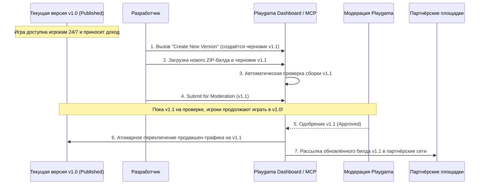

# 12. Обновления после релиза, версионирование и поддержка (Post-Release Updates & Maintenance)

> **Статус документа:** `VERIFIED`  
> **Дата последней верификации:** `2026-11-08`  
> **Первичные источники:**  
> - [Submitting a Game](https://wiki.playgama.com/playgama/submitting-a-game)  
> - [Playgama MCP Tools — `create_new_game_version`](https://wiki.playgama.com/playgama/mcp/tools)  
> - [Saving Player Progress Guide](https://wiki.playgama.com/playgama/guides/saving-progress)  
> - [Bridge SDK — Setup & Changelog](https://wiki.playgama.com/playgama/bridge-sdk/changelog)

---

## 1. Как работает обновление уже опубликованной игры (`VERIFIED`)

В экосистеме Playgama реализована безопасная модель **непрерывной публикации с версионированием (Blue/Green Versioning)** ([MCP Tools — `create_new_game_version`](https://wiki.playgama.com/playgama/mcp/tools)):



### 1.1. Ответы на ключевые эксплуатационные вопросы (`VERIFIED`)

| Вопрос | Официальное поведение платформы | Статус |
|---|---|---|
| **Проходит ли обновление повторную модерацию?** | **Да.** Каждый новый загруженный ZIP-билд проходит автоматическую валидацию и проверку модератором, чтобы исключить случайную поломку звука, рекламы или сохранений в патче. | `VERIFIED` |
| **Останавливается ли показ игры и доход на время модерации патча?** | **Нет.** Предыдущая одобренная версия остаётся полностью активной на `playgama.com` и у всех партнёров до момента утверждения новой версии. | `VERIFIED` |
| **Как обновление доставляется на партнёрские площадки?** | На `playgama.com` и в собственной iframe-сети билд обновляется мгновенно после аппрува модератором. На управляемых партнёрских витринах (Yandex, GameDistribution, YouTube Playables и др.) обновление доставляется релиз-пайплайном Playgama (на курируемых площадках вроде YouTube патч также проходит быструю проверку целостности на стороне партнёра). | `VERIFIED` |

---

## 2. Совместимость сохранений между версиями (`Save Schema Migration`)

> [!CAUTION]
> **Главная опасность при выпуске обновления:**  
> У тысяч игроков, уже игравших в версию `1.0`, в облачном хранилище (`bridge.storage` / `ytgame.game.saveData`) и в `localStorage` лежат сохранения старого формата. Если версия `1.1` изменит структуру объекта сохранения без миграции и упадёт с `TypeError: Cannot read properties of undefined`, игра словит перманентный краш при запуске у всех старых игроков (`Rule 1.7.1`)!

### 2.1. Обязательный стандарт версионирования сохранений (`RECOMMENDED`)
1. Всегда храните поле `"schemaVersion": number` внутри корневого JSON-объекта сохранения.
2. При загрузке данных через `bridge.storage.get()` пропускайте полученный объект через чистую функцию-мигратор `migrateSaveData(raw)` с защитным `try / catch`.
3. Никогда не переименовывайте главный ключ хранилища между патчами (например, фиксируйте единый ключ `'pg_save_state'`) — меняйте только внутреннюю версию схемы и дополняйте новые поля дефолтными значениями.

---

## 3. Стратегия обновления Playgama Bridge SDK (`CDN vs NPM`)

### 3.1. Как обновляется сам SDK (`VERIFIED`, источник: [Bridge SDK — Setup](https://wiki.playgama.com/playgama/bridge-sdk/setup))
- При подключении скрипта через официальный стабильный URL:
  ```html
  <script src="https://bridge.playgama.com/v2/stable/playgama-bridge.js"></script>
  ```
  или при использовании Vite-плагина `@playgama/bridge/vite` в режиме по умолчанию (CDN), ваша опубликованная игра **автоматически получает все обратно совместимые минорные и патч-обновления ветки `v2.x`** (например, `2.3.0 → 2.4.0 → 2.4.1`), включая хотфиксы платформенных адаптеров YouTube, MSN, Facebook и Telegram **без необходимости пересобирать и перезаливать ZIP-архив игры**!
- Если вы используете NPM-пакет `@playgama/bridge` для строгой типизации TypeScript и констант (`@playgama/bridge/constants`), периодически обновляйте зависимость (`npm update @playgama/bridge`) перед сборкой очередного контентного патча.
