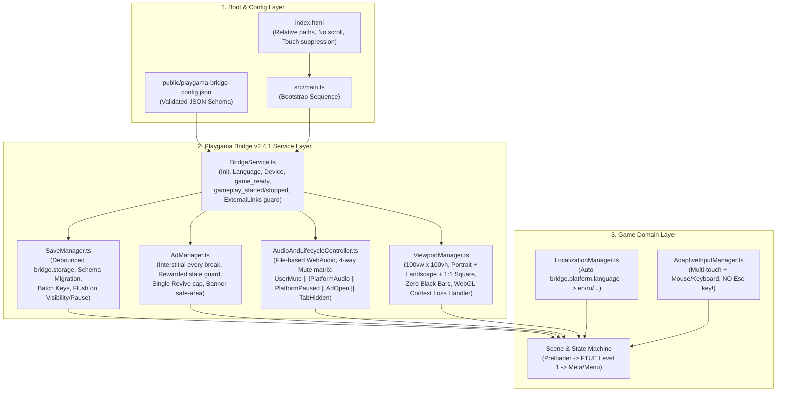

# 13. Эталонная техническая архитектура HTML5-игры для Playgama (Playgama-Only Technical Architecture)

> **Статус документа:** `VERIFIED` (API `@playgama/bridge@2.4.1` и правила `1.1–5.1`) + `RECOMMENDED` (инженерная архитектура)  
> **Дата последней верификации:** `2026-11-08`  
> **Целевой стек:** TypeScript 5.x + Vite 6.x + `@playgama/bridge@2.4.1` (`@playgama/bridge/vite`) + HTML5 Canvas / WebGL 2.0

---

## 1. Архитектурные принципы «Playgama-First & YouTube-Ready»

Данная архитектура спроектирована специально под публикацию **исключительно через Playgama** с прицелом на автоматическое прохождение как базовой модерации `playgama.com`, так и самой строгой партнёрской сертификации (**YouTube Playables**, **MSN**, **Facebook Gaming**, **Xiaomi**, **GameSnacks**, **Playhop/Yandex**):



---

## 2. Рекомендуемая структура директорий проекта

```text
my-playgama-game/
├── public/
│   ├── playgama-bridge-config.json   # ОБЯЗАТЕЛЬНЫЙ конфиг (копируется в корень dist/)
│   └── assets/
│       ├── atlases/                  # WebP текстурные атласы (<= 2048x2048 px)
│       ├── audio/                    # Студийные .mp3 / .ogg файлы (0 процедурных писков!)
│       └── fonts/                    # Локальные .woff2 шрифты (0 внешних Google Fonts!)
├── scripts/
│   └── validate-release.mjs          # Предрелизный валидатор (< 25 MB, <= 500 файлов, ASCII пути)
├── src/
│   ├── main.ts                       # Точка входа и строгий порядок инициализации
│   ├── platform/
│   │   ├── BridgeService.ts          # Обёртка над @playgama/bridge v2.4.1
│   │   ├── SaveManager.ts            # Облачное/локальное сохранение с миграцией и debounce
│   │   ├── AdManager.ts              # Управление Interstitial, Rewarded и баннерами
│   │   ├── AudioController.ts        # Многофакторный контроллер звука и жизненного цикла
│   │   ├── ViewportManager.ts        # Адаптивный ресайз (9:16, 1:1, 16:9 без чёрных полос)
│   │   └── TelemetryService.ts       # Обёртка над bridge.analytics.send()
│   ├── core/
│   │   ├── AdaptiveInput.ts          # Мультитач + Клавиатура (с блокировкой Esc и скролла)
│   │   └── I18n.ts                   # Автоопределение языка из bridge.platform.language
│   └── game/
│       └── GameApp.ts                # Игровой цикл и сцены
├── index.html
├── vite.config.ts
├── tsconfig.json
└── package.json
```

---

## 3. Эталонная конфигурация сборки (`vite.config.ts` и `index.html`)

### 3.1. `vite.config.ts` (Относительные пути `./` + плагин `@playgama/bridge/vite`)

```typescript
import { defineConfig } from 'vite';
import { playgamaBridge } from '@playgama/bridge/vite';

export default defineConfig({
  // КРИТИЧНО (Rule 1.3.2): строго относительные пути './' для работы в любой подпапке CDN/iframe
  base: './',
  plugins: [
    // Инжектирует https://bridge.playgama.com/v2/stable/playgama-bridge.js
    // Для полностью локальной офлайн-отладки можно временно передать { mode: 'local' }
    playgamaBridge(),
  ],
  build: {
    outDir: 'dist',
    assetsDir: 'assets',
    emptyOutDir: true,
    target: 'es2020',
    assetsInlineLimit: 4096,
    rollupOptions: {
      output: {
        // Гарантируем чистые ASCII-имена файлов (Rule 1.3.2 и YouTube Playables YT-3)
        entryFileNames: 'assets/[name]-[hash].js',
        chunkFileNames: 'assets/[name]-[hash].js',
        assetFileNames: 'assets/[name]-[hash][extname]',
      },
    },
  },
});
```

### 3.2. `index.html` (Подавление скролла, выделения, зума и контекстного меню — `Rules 1.4.5, 1.6.3`)

```html
<!DOCTYPE html>
<html lang="en">
<head>
  <meta charset="UTF-8" />
  <meta name="viewport" content="width=device-width, initial-scale=1.0, maximum-scale=1.0, user-scalable=no, viewport-fit=cover" />
  <title>Game</title>
  <style>
    * {
      box-sizing: border-box;
      user-select: none;
      -webkit-user-select: none;
      -webkit-touch-callout: none;
      -webkit-tap-highlight-color: transparent;
    }
    html, body {
      margin: 0;
      padding: 0;
      width: 100%;
      height: 100%;
      overflow: hidden; /* Rule 1.6.3: запрет скроллбаров */
      background-color: #121624; /* Не чисто чёрный фон против эффекта "black bars" */
      touch-action: none; /* Rule 1.4.5: запрет pull-to-refresh и системного пинч-зума */
    }
    #game-container {
      position: relative;
      width: 100vw;
      height: 100vh;
      overflow: hidden;
    }
    canvas {
      display: block;
      width: 100%;
      height: 100%;
      outline: none;
    }
    /* Визуальный лоадер с первой миллисекунды (Rule 3.1.1) */
    #boot-loader {
      position: absolute;
      inset: 0;
      display: flex;
      flex-direction: column;
      align-items: center;
      justify-content: center;
      background: radial-gradient(circle at center, #1e293b 0%, #0f172a 100%);
      color: #f8fafc;
      font-family: sans-serif;
      z-index: 100;
      transition: opacity 0.25s ease;
    }
    .progress-track {
      width: min(260px, 70vw);
      height: 10px;
      background: rgba(255, 255, 255, 0.15);
      border-radius: 999px;
      overflow: hidden;
      margin-top: 16px;
    }
    #boot-progress-bar {
      width: 5%;
      height: 100%;
      background: linear-gradient(90deg, #38bdf8, #818cf8);
      transition: width 0.15s ease;
    }
  </style>
</head>
<body oncontextmenu="return false;" ondragstart="return false;">
  <div id="game-container">
    <canvas id="game-canvas" tabindex="0"></canvas>
    <div id="boot-loader">
      <div id="boot-title">LOADING...</div>
      <div class="progress-track">
        <div id="boot-progress-bar"></div>
      </div>
    </div>
  </div>
  <script type="module" src="./src/main.ts"></script>
</body>
</html>
```

---

## 4. Ключевые архитектурные сервисы (TypeScript)

### 4.1. `AudioController.ts` — Безусловное соблюдение правил звука и паузы (`Rules 3.3.1–3.3.5`)

> [!IMPORTANT]
> Звук в игре должен звучать **тогда и только тогда**, когда одновременно истинны все 5 условий:
> `!userMuted && platformAudioEnabled && !platformPaused && !adOpened && !documentHidden`

```typescript
import bridge, { EVENT_NAME } from '@playgama/bridge';

export class AudioController {
  private ctx: AudioContext | null = null;
  private masterGain: GainNode | null = null;

  private userMuted = false;
  private platformAudioEnabled = true;
  private platformPaused = false;
  private adOpened = false;
  private documentHidden = false;

  constructor(initialUserMuted = false) {
    this.userMuted = initialUserMuted;
    this.initPlatformListeners();
    this.initBrowserVisibilityListeners();
  }

  private initPlatformListeners(): void {
    if (!bridge.isInitialized) return;
    this.platformAudioEnabled = bridge.platform.isAudioEnabled;
    this.platformPaused = bridge.platform.isPaused;

    bridge.platform.on(EVENT_NAME.AUDIO_STATE_CHANGED, (enabled: boolean) => {
      this.platformAudioEnabled = enabled;
      this.syncAudioState();
    });

    bridge.platform.on(EVENT_NAME.PAUSE_STATE_CHANGED, (paused: boolean) => {
      this.platformPaused = paused;
      this.syncAudioState();
    });
  }

  private initBrowserVisibilityListeners(): void {
    document.addEventListener('visibilitychange', () => {
      this.documentHidden = document.visibilityState === 'hidden';
      this.syncAudioState();
    });
    window.addEventListener('pagehide', () => {
      this.documentHidden = true;
      this.syncAudioState();
    });
    window.addEventListener('pageshow', () => {
      this.documentHidden = document.visibilityState === 'hidden';
      this.syncAudioState();
    });
  }

  public setAdOpened(opened: boolean): void {
    this.adOpened = opened;
    this.syncAudioState();
  }

  public setUserMuted(muted: boolean): void {
    this.userMuted = muted;
    this.syncAudioState();
  }

  public isUserMuted(): boolean {
    return this.userMuted;
  }

  public shouldPlayAudio(): boolean {
    return (
      !this.userMuted &&
      this.platformAudioEnabled &&
      !this.platformPaused &&
      !this.adOpened &&
      !this.documentHidden
    );
  }

  private syncAudioState(): void {
    if (!this.ctx || !this.masterGain) return;

    if (this.shouldPlayAudio()) {
      if (this.ctx.state === 'suspended') {
        this.ctx.resume().catch(() => {});
      }
      this.masterGain.gain.setValueAtTime(1, this.ctx.currentTime);
    } else {
      this.masterGain.gain.setValueAtTime(0, this.ctx.currentTime);
      if (this.ctx.state === 'running') {
        this.ctx.suspend().catch(() => {});
      }
    }
  }
}
```

---

### 4.2. `SaveManager.ts` — Сохранение с миграцией схемы, батчингом и защитой от Rate-Limit (`Rule 1.1.3`)

```typescript
import bridge, { EVENT_NAME } from '@playgama/bridge';

export interface PlayerSaveDataV1 {
  schemaVersion: 1;
  level: number;
  coins: number;
  highScore: number;
  userMuted: boolean;
  unlockedItems: string[];
  updatedAt: number;
}

const STORAGE_KEY = 'pg_game_save_v1';
const DEBOUNCE_MS = 1500;

export const DEFAULT_SAVE: PlayerSaveDataV1 = {
  schemaVersion: 1,
  level: 1,
  coins: 0,
  highScore: 0,
  userMuted: false,
  unlockedItems: [],
  updatedAt: 0,
};

export class SaveManager {
  private state: PlayerSaveDataV1 = { ...DEFAULT_SAVE };
  private saveTimeoutId: number | null = null;
  private isDirty = false;

  public async load(): Promise<PlayerSaveDataV1> {
    if (!bridge.isInitialized) return this.state;

    try {
      const raw = await bridge.storage.get(STORAGE_KEY);
      if (raw) {
        const parsed = typeof raw === 'string' ? JSON.parse(raw) : raw;
        this.state = this.migrate(parsed);
      }
    } catch (err) {
      console.warn('[SaveManager] Failed to load save, using defaults:', err);
    }

    // При переключении хранилища или сворачивании вкладки сбрасываем несохранённый буфер
    bridge.storage.on(EVENT_NAME.PLATFORM_STORAGE_AVAILABILITY_CHANGED, () => {
      if (this.isDirty) void this.flushNow();
    });
    document.addEventListener('visibilitychange', () => {
      if (document.visibilityState === 'hidden' && this.isDirty) {
        void this.flushNow();
      }
    });

    return this.state;
  }

  public getState(): Readonly<PlayerSaveDataV1> {
    return this.state;
  }

  public patch(partial: Partial<Omit<PlayerSaveDataV1, 'schemaVersion'>>): void {
    this.state = {
      ...this.state,
      ...partial,
      updatedAt: Date.now(),
    };
    this.isDirty = true;
    this.scheduleSave();
  }

  private scheduleSave(): void {
    if (this.saveTimeoutId !== null) {
      window.clearTimeout(this.saveTimeoutId);
    }
    this.saveTimeoutId = window.setTimeout(() => {
      this.saveTimeoutId = null;
      void this.flushNow();
    }, DEBOUNCE_MS);
  }

  public async flushNow(): Promise<void> {
    if (!bridge.isInitialized || !this.isDirty) return;
    this.isDirty = false;
    try {
      // Передаём сериализованный JSON (совместимо с YouTube ytgame.game.saveData и всеми платформами)
      await bridge.storage.set(STORAGE_KEY, JSON.stringify(this.state));
    } catch (err) {
      console.warn('[SaveManager] Failed to persist save:', err);
    }
  }

  private migrate(raw: unknown): PlayerSaveDataV1 {
    if (!raw || typeof raw !== 'object') return { ...DEFAULT_SAVE };
    const obj = raw as Record<string, unknown>;
    return {
      schemaVersion: 1,
      level: typeof obj.level === 'number' && obj.level >= 1 ? obj.level : 1,
      coins: typeof obj.coins === 'number' && obj.coins >= 0 ? obj.coins : 0,
      highScore: typeof obj.highScore === 'number' ? obj.highScore : 0,
      userMuted: typeof obj.userMuted === 'boolean' ? obj.userMuted : false,
      unlockedItems: Array.isArray(obj.unlockedItems)
        ? obj.unlockedItems.filter((x): x is string => typeof x === 'string')
        : [],
      updatedAt: typeof obj.updatedAt === 'number' ? obj.updatedAt : Date.now(),
    };
  }
}
```

---

### 4.3. `AdaptiveInput.ts` — Защита от скролла страницы и строгий запрет `Esc` (`Rules 1.4.1–1.5.2`)

```typescript
const SCROLL_KEYS = new Set([
  'Space',
  'ArrowUp',
  'ArrowDown',
  'ArrowLeft',
  'ArrowRight',
  'Tab',
]);

export function setupSafeKeyboardControls(
  onAction: (code: string, pressed: boolean) => void,
  onPauseToggle: () => void
): void {
  window.addEventListener(
    'keydown',
    (e: KeyboardEvent) => {
      // Rule 1.5.2: СТРОГИЙ ЗАПРЕТ использования клавиши Escape!
      if (e.key === 'Escape' || e.code === 'Escape') {
        return;
      }

      // Rule 1.5.1: блокируем прокрутку родительской страницы стрелками и пробелом
      if (SCROLL_KEYS.has(e.code)) {
        e.preventDefault();
      }

      // Для паузы используем клавишу P
      if (e.code === 'KeyP' && !e.repeat) {
        onPauseToggle();
        return;
      }

      onAction(e.code, true);
    },
    { passive: false }
  );

  window.addEventListener('keyup', (e: KeyboardEvent) => {
    if (e.key === 'Escape' || e.code === 'Escape') return;
    onAction(e.code, false);
  });
}
```

---

## 5. Автоматический скрипт предрелизной валидации архива (`scripts/validate-release.mjs`)

Поместите этот скрипт в `scripts/validate-release.mjs` и запускайте его после `npm run build` — он автоматически проверяет соблюдение лимитов Playgama, YouTube Playables (`< 30 MB`, ASCII-имена) и Facebook (`<= 500` файлов):

```javascript
import fs from 'node:fs';
import path from 'node:path';

const DIST_DIR = path.resolve('dist');
const MAX_TOTAL_BYTES_YOUTUBE = 30 * 1024 * 1024; // 30 MB YouTube Playables limit
const MAX_SINGLE_FILE_BYTES_GAMESNACKS = 10 * 1024 * 1024; // 10 MiB GameSnacks limit
const MAX_FILE_COUNT_FACEBOOK = 500; // 500 files Facebook Gaming limit
const SAFE_PATH_REGEX = /^[a-zA-Z0-9._/-]+$/;

function walk(dir, fileList = []) {
  for (const entry of fs.readdirSync(dir, { withFileTypes: true })) {
    const full = path.join(dir, entry.name);
    if (entry.isDirectory()) {
      walk(full, fileList);
    } else {
      fileList.push(full);
    }
  }
  return fileList;
}

const errors = [];
if (!fs.existsSync(path.join(DIST_DIR, 'index.html'))) {
  errors.push('CRITICAL (Rule 1.3.2): index.html is missing in dist/ root!');
}

const configPath = path.join(DIST_DIR, 'playgama-bridge-config.json');
if (!fs.existsSync(configPath)) {
  errors.push('CRITICAL (Rule 1.1.1): playgama-bridge-config.json is missing in dist/ root!');
} else {
  const cfg = JSON.parse(fs.readFileSync(configPath, 'utf8'));
  if (cfg.forciblySetPlatformId) {
    errors.push(`CRITICAL: "forciblySetPlatformId" must be empty in production, got "${cfg.forciblySetPlatformId}"`);
  }
}

const files = walk(DIST_DIR);
let totalBytes = 0;

for (const file of files) {
  const rel = path.relative(DIST_DIR, file).replace(/\\/g, '/');
  const size = fs.statSync(file).size;
  totalBytes += size;

  if (!SAFE_PATH_REGEX.test(rel)) {
    errors.push(`Rule 1.3.2 / YT-3 Violation: Invalid filename characters in "${rel}"`);
  }
  if (size > MAX_SINGLE_FILE_BYTES_GAMESNACKS) {
    errors.push(`Partner Quota Warning: File "${rel}" (${(size / 1048576).toFixed(2)} MB) exceeds 10 MiB GameSnacks limit`);
  }
}

if (files.length > MAX_FILE_COUNT_FACEBOOK) {
  errors.push(`Partner Quota Violation: ${files.length} files exceeds Facebook Gaming limit of ${MAX_FILE_COUNT_FACEBOOK}`);
}
if (totalBytes >= MAX_TOTAL_BYTES_YOUTUBE) {
  errors.push(`YouTube Playables Quota Violation: Total size ${(totalBytes / 1048576).toFixed(2)} MB exceeds 30 MB limit`);
}

console.log(`Build stats: ${files.length} files, ${(totalBytes / 1048576).toFixed(2)} MB total.`);
if (errors.length > 0) {
  console.error('Release validation FAILED:\n - ' + errors.join('\n - '));
  process.exit(1);
}
console.log('Release validation PASSED for Playgama + YouTube Playables + MSN + Facebook + GameSnacks!');
```
